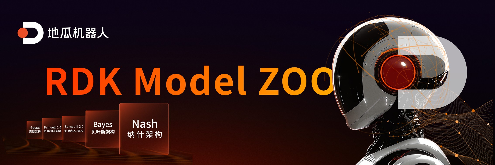
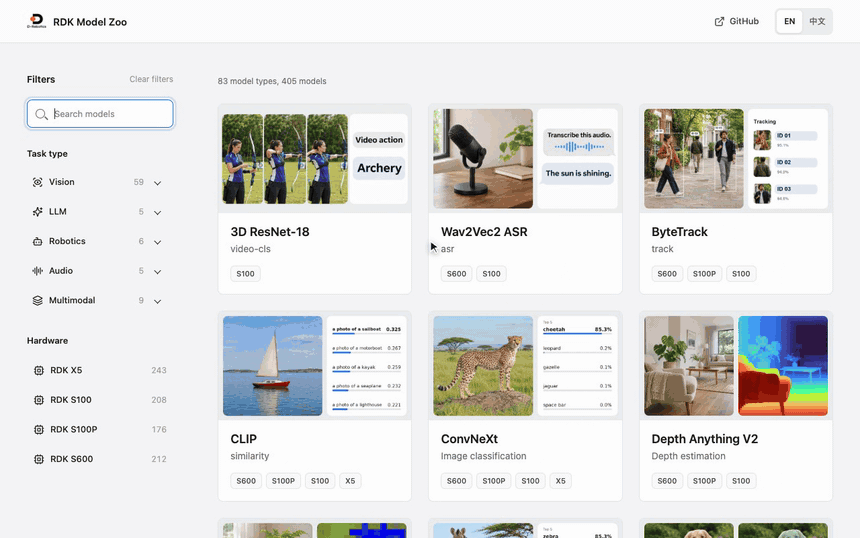
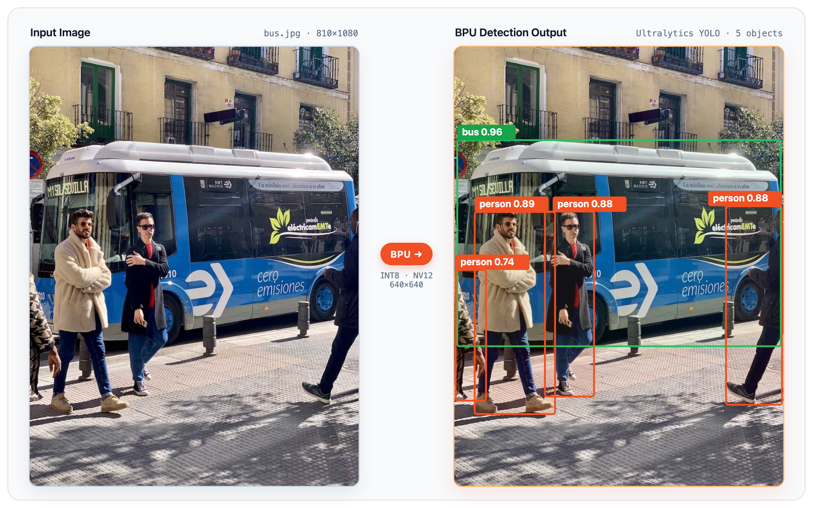
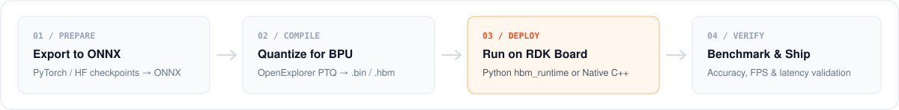

<div align="center">
  

  <h1>RDK Model Zoo</h1>
  <p>Ready-to-run AI models and BPU quantization workflows for D-Robotics RDK boards.</p>

  **English** &nbsp;/&nbsp; [简体中文](./README_cn.md)

  <p align="center">
    <a href="https://d-robotics.github.io/rdk_model_zoo/"></a>
    <a href="https://github.com/D-Robotics/rdk_model_zoo/releases"></a>
    <a href="https://github.com/D-Robotics/rdk_model_zoo/stargazers"></a>
    <a href="./LICENSE"></a>
  </p>

  <p align="center">
    <a href="#web-model-catalog">Web Catalog</a> &nbsp;·&nbsp;
    <a href="#quick-start">Quick Start</a> &nbsp;·&nbsp;
    <a href="#how-it-works">How It Works</a> &nbsp;·&nbsp;
    <a href="#hardware-support">Hardware</a> &nbsp;·&nbsp;
    <a href="#model-list">Models</a> &nbsp;·&nbsp;
    <a href="#documentation">Docs &amp; Toolchains</a> &nbsp;·&nbsp;
    <a href="#faq">FAQ</a>
  </p>
</div>

---

<a id="web-model-catalog"></a>
## Overview & Web Model Catalog

**RDK Model Zoo** is D-Robotics' official collection of AI models ready to run on BPU (Brain Processing Unit) hardware across Vision, LLM, Speech, VLA, and Robotics. Every sample includes precompiled model download scripts, runnable Python (`hbm_runtime`) or native C++ inference code, and end-to-end quantization guides.

Use the interactive **[Web Model Catalog](https://d-robotics.github.io/rdk_model_zoo/)** to filter models by board or task, compare measured latency and accuracy, and copy ready-to-run commands:

<a href="https://d-robotics.github.io/rdk_model_zoo/">
  
</a>

<p align="center">
  <a href="https://d-robotics.github.io/rdk_model_zoo/"><b>Open the Web Model Catalog →</b></a>
</p>

---

<a id="quick-start"></a>
## Quick Start

Run Ultralytics YOLO11x object detection on **RDK X5** (`RDK OS >= 3.5.0`) in two steps:

```bash
# 1. Download the precompiled BPU model
cd samples/vision/ultralytics_yolo/model
bash download_model.sh --platform x5 --family yolo11 --task detect --model-size x

# 2. Run on-board inference
cd ../runtime/python
python3 main.py \
  --task detect \
  --platform x5 \
  --family yolo11 \
  --model-size x \
  --test-img ../../test_data/bus.jpg \
  --img-save-path ../../test_data/inference_yolo11x.jpg
```

<div align="center">
  
</div>

> For other boards or models, check the target sample's `README.md` first for supported artifacts, C++ build steps, and runtime flags.

---

<a id="how-it-works"></a>
## How It Works

Every sample follows the same four-stage workflow from upstream weights to verified board deployment:

<picture>
  <source media="(prefers-color-scheme: dark)" srcset="docs/assets/pipeline_dark.svg" />
  <source media="(prefers-color-scheme: light)" srcset="docs/assets/pipeline_light.svg" />
  
</picture>

- **One layout across all boards** — X5 and S-series boards share the same `samples/` directory, using `--target` / `--platform` to select hardware.
- **Full conversion recipes included** — Each sample documents ONNX export, OpenExplorer quantization (`.bin` / `.hbm`), and calibration steps so you can deploy your own fine-tuned weights.
- **Readable Python & fast C++** — Python runtimes follow a clean `preprocess -> infer -> postprocess` pattern; C++ runtimes target peak edge throughput.

---

<a id="hardware-support"></a>
## Supported Hardware

| Board | Target ID | CPU | BPU (INT8) | Artifacts |
| :--- | :--- | :--- | :--- | :--- |
| **[RDK X5](https://www.d-robotics.cc/rdkX5)** | `x5` | 8× Cortex-A55 | 1× Bayes-E, 10 TOPS | [`docs/release/x5/`](docs/release/x5) |
| **[RDK S100](https://www.d-robotics.cc/rdkS100)** | `s100` | 6× Cortex-A78AE | 1× Nash-E, 80 TOPS | [`docs/release/s/`](docs/release/s) |
| **[RDK S100P](https://www.d-robotics.cc/rdkS100)** | `s100p` | 6× Cortex-A78AE | 1× Nash-M, 128 TOPS | [`docs/release/s/`](docs/release/s) |
| **[RDK S600](https://www.d-robotics.cc/rdkS600)** | `s600` | 18× Cortex-A78AE | 4× Nash-P, 560 TOPS | [`docs/release/s/`](docs/release/s) |

All four boards run **RDK OS** (`>= 3.5.0` recommended for RDK X5; match the board image and runtime to published artifacts on S100/S100P/S600).

**Branch lines:** [`main`](https://github.com/D-Robotics/rdk_model_zoo/tree/main) is the release delivery branch; [`develop`](https://github.com/D-Robotics/rdk_model_zoo/tree/develop) is the active development branch. Legacy per-board lines remain on [`rdk_x5`](https://github.com/D-Robotics/rdk_model_zoo/tree/rdk_x5) and [`rdk_s`](https://github.com/D-Robotics/rdk_model_zoo/tree/rdk_s); RDK X3 is archived on [`rdk_x3`](https://github.com/D-Robotics/rdk_model_zoo/tree/rdk_x3).

---

<a id="model-list"></a>
## Models & Repository Structure

| Domain | Count | Representative Models | Entry |
| :--- | :---: | :--- | :--- |
| **Vision** | 49 | Ultralytics YOLO, MobileSAM, Depth Anything V2, PaddleOCR, CLIP | [`samples/README.md`](./samples/README.md) |
| **LLM / VLM** | 4 | OELLM S600 Suite (32 profiles), Gemma4 (E2B / E4B), MiniCPM5-2B | [`samples/llm/`](./samples/llm) |
| **Speech** | 3 | ASR (Wav2Vec2 / XLSR53), Paraformer, Keyword Spotting (KWS) | [`samples/speech/`](./samples/speech) |
| **VLA** | 2 | Upstream ACT & Pi0 integrations (pinned Git submodules) | [`samples/vla/README.md`](./samples/vla/README.md) |
| **Robotics** | 1 | HIMLoco legged locomotion policy (Unitree Go2) | [`samples/robotics/himloco`](./samples/robotics/himloco) |

<details>
<summary><b>Expand full model list (by category and platform)</b></summary>

<br>

| Category | Model | Supported Boards (RDK) | Path |
| :--- | :--- | :--- | :--- |
| Video Action Classification | 3D ResNet | S100 | [`samples/vision/3dresnet`](./samples/vision/3dresnet) |
| Image Classification | ConvNeXt | X5 | [`samples/vision/convnext`](./samples/vision/convnext) |
| Image Classification | EdgeNeXt | X5 | [`samples/vision/edgenext`](./samples/vision/edgenext) |
| Image Classification | EfficientFormer | X5 | [`samples/vision/efficientformer`](./samples/vision/efficientformer) |
| Image Classification | EfficientFormerV2 | X5 | [`samples/vision/efficientformerv2`](./samples/vision/efficientformerv2) |
| Image Classification | EfficientNet | X5/S100/S600 | [`samples/vision/efficientnet`](./samples/vision/efficientnet) |
| Image Classification | EfficientViT | X5 | [`samples/vision/efficientvit`](./samples/vision/efficientvit) |
| Image Classification | FasterNet | X5 | [`samples/vision/fasternet`](./samples/vision/fasternet) |
| Image Classification | FastViT | X5 | [`samples/vision/fastvit`](./samples/vision/fastvit) |
| Image Classification | GoogLeNet | X5 | [`samples/vision/googlenet`](./samples/vision/googlenet) |
| Image Classification | HGNetV2 | X5 | [`samples/vision/hgnetv2`](./samples/vision/hgnetv2) |
| Image Classification | MobileNetV1 | X5/S100/S100P/S600 | [`samples/vision/mobilenetv1`](./samples/vision/mobilenetv1) |
| Image Classification | MobileNetV2 | X5/S100/S100P/S600 | [`samples/vision/mobilenetv2`](./samples/vision/mobilenetv2) |
| Image Classification | MobileNetV3 | S100/S100P/S600 | [`samples/vision/mobilenetv3`](./samples/vision/mobilenetv3) |
| Image Classification | MobileNetV4 | X5/S100/S100P/S600 | [`samples/vision/mobilenetv4`](./samples/vision/mobilenetv4) |
| Image Classification | MobileOne | X5 | [`samples/vision/mobileone`](./samples/vision/mobileone) |
| Image Classification | RepGhost | X5 | [`samples/vision/repghost`](./samples/vision/repghost) |
| Image Classification | RepVGG | X5 | [`samples/vision/repvgg`](./samples/vision/repvgg) |
| Image Classification | RepViT | X5 | [`samples/vision/repvit`](./samples/vision/repvit) |
| Image Classification | ResNet | X5/S100/S100P/S600 | [`samples/vision/resnet`](./samples/vision/resnet) |
| Image Classification | ResNeXt | X5 | [`samples/vision/resnext`](./samples/vision/resnext) |
| Image Classification | VargConvNet | X5 | [`samples/vision/vargconvnet`](./samples/vision/vargconvnet) |
| Image Classification | ViT | S100 | [`samples/vision/vit`](./samples/vision/vit) |
| Person Re-Identification | OSNet x1.0 | X5/S100/S100P/S600 | [`samples/vision/osnet`](./samples/vision/osnet) |
| Multi-Object Tracking | ByteTrack | X5/S100/S100P/S600 | [`samples/vision/bytetrack`](./samples/vision/bytetrack) |
| Multi-Object Tracking | HobotMot (IOU 2.0) | X5/S100/S100P/S600 | [`samples/vision/hobot_mot`](./samples/vision/hobot_mot) |
| Object Detection / Tracking | Faster R-CNN MobileNetV3-Large | X5/S100/S100P/S600 | [`samples/vision/fasterrcnn`](./samples/vision/fasterrcnn) |
| Promptable Segmentation | EfficientSAM-Tiny | X5/S100/S100P/S600 | [`samples/vision/efficient_sam`](./samples/vision/efficient_sam) |
| Promptable Segmentation | MobileSAM | X5/S100/S100P/S600 | [`samples/vision/mobile_sam`](./samples/vision/mobile_sam) |
| Monocular Depth Estimation | Depth Anything V2 | S100 | [`samples/vision/depth_anything_v2`](./samples/vision/depth_anything_v2) |
| Monocular Depth Estimation | YOLO26 Depth | X5/S100/S100P/S600 | [`samples/vision/yolo26_depth`](./samples/vision/yolo26_depth) |
| Semantic Segmentation | PP-LiteSeg | X5 | [`samples/vision/pp_liteseg`](./samples/vision/pp_liteseg) |
| Semantic Segmentation | UNet ResNet Family | X5 | [`samples/vision/unet`](./samples/vision/unet) |
| Semantic Segmentation | UNetMobileNet | S100/S600 | [`samples/vision/unetmobilenet`](./samples/vision/unetmobilenet) |
| Lane Detection | LaneNet | S100 | [`samples/vision/lanenet`](./samples/vision/lanenet) |
| Object Detection | FCOS | X5 | [`samples/vision/fcos`](./samples/vision/fcos) |
| Object Detection | YOLOv5 | X5/S100/S600 | [`samples/vision/yolov5`](./samples/vision/yolov5) |
| Multi-Task Vision | Ultralytics YOLO (`YOLOv5u–YOLO26`) | X5/S100/S100P/S600 | [`samples/vision/ultralytics_yolo`](./samples/vision/ultralytics_yolo) |
| Prompt-Free Segmentation | YOLOE | X5/S100/S100P | [`samples/vision/yoloe`](./samples/vision/yoloe) |
| Open-Vocabulary Detection | YOLOWorld | X5 | [`samples/vision/yoloworld`](./samples/vision/yoloworld) |
| Point Cloud Segmentation | PointNet | S100 | [`samples/vision/pointnet`](./samples/vision/pointnet) |
| Image Matting | MODNet | X5 | [`samples/vision/modnet`](./samples/vision/modnet) |
| OCR Detection & Recognition | PaddleOCR | X5/S100/S600 | [`samples/vision/paddle_ocr`](./samples/vision/paddle_ocr) |
| License Plate Recognition | LPRNet | X5 | [`samples/vision/lprnet`](./samples/vision/lprnet) |
| Image-Text Matching | CLIP | X5 | [`samples/vision/clip`](./samples/vision/clip) |
| Vision Feature Encoder | DINOv2 | S100/S100P/S600 | [`samples/vision/dinov2`](./samples/vision/dinov2) |
| Vision-Language Encoder | SigLIP | S100/S100P | [`samples/vision/siglip`](./samples/vision/siglip) |
| Audio-Driven Avatar | LiteAvatar | S100/S100P/S600 | [`samples/vision/lite_avatar`](./samples/vision/lite_avatar) |
| Speech Recognition | ASR (Wav2Vec2 / XLSR53) | S100/S600 | [`samples/speech/asr`](./samples/speech/asr) |
| Keyword Spotting | KWS | S100 | [`samples/speech/kws`](./samples/speech/kws) |
| Speech Recognition | Paraformer | S100 | [`samples/speech/paraformer`](./samples/speech/paraformer) |
| End-to-End Driving | DiffusionDrive | S100P/S600 | [`samples/vision/diffusiondrive`](./samples/vision/diffusiondrive) |
| Legged Locomotion | HIMLoco (Unitree Go2) | X5 | [`samples/robotics/himloco`](./samples/robotics/himloco) |
| LLM / VLM Suite | Official OELLM Suite (SDK 2.0.0) | S600 | [`samples/llm/oellm`](./samples/llm/oellm) |
| Text Generation | Gemma4 E2B/E4B (SDK 2.0) | S600 | [`samples/llm/gemma4`](./samples/llm/gemma4) |
| Vision-Language Model | Gemma4-E2B (native C++) | S100/S100P/S600 | [`samples/llm/gemma4-e2b`](./samples/llm/gemma4-e2b) |
| Text Generation | MiniCPM5-2B (native C++) | S100/S100P/S600 | [`samples/llm/minicpm5-2b`](./samples/llm/minicpm5-2b) |

Some samples are archival or reference implementations, or require a local detector, C++ runtime, or user-supplied model files; check each sample's support table for exact requirements.

</details>

<details>
<summary><b>Expand repository directory structure</b></summary>

<br>

```text
rdk_model_zoo/
├── samples/
│   ├── llm/                     # On-device LLM & VLM runtimes (native C++ / OELLM SDK)
│   │   ├── gemma4/              # Gemma4 E2B / E4B text generation (OELLM SDK 2.0.0)
│   │   ├── gemma4-e2b/          # Gemma4-E2B VLM chat & HTTP runtime (native C++)
│   │   ├── minicpm5-2b/         # MiniCPM5-2B text generation (native C++)
│   │   └── oellm/               # Official OELLM SDK 2.0.0 S600 model suite
│   ├── robotics/
│   │   └── himloco/             # Unitree Go2 locomotion policy
│   ├── speech/
│   │   ├── asr/                 # Speech recognition (Wav2Vec2 / XLSR53)
│   │   ├── kws/                 # Keyword spotting
│   │   └── paraformer/          # Paraformer speech recognition
│   ├── vla/                     # Upstream VLA integrations (ACT / Pi0, pinned submodules)
│   └── vision/                  # 49 computer vision & multimodal samples
│       ├── 3dresnet/            # Video action classification
│       ├── bytetrack/           # Multi-object tracking
│       ├── clip/                # Image-text multimodal matching
│       ├── convnext/            # Image classification
│       ├── depth_anything_v2/   # Monocular depth estimation
│       ├── diffusiondrive/      # End-to-end driving planning
│       ├── dinov2/              # Vision feature encoder
│       ├── edgenext/            # Image classification
│       ├── efficient_sam/       # Promptable image segmentation
│       ├── efficientformer/     # Image classification
│       ├── efficientformerv2/   # Image classification
│       ├── efficientnet/        # Image classification
│       ├── efficientvit/        # Image classification
│       ├── fasterrcnn/          # COCO detection & person tracking
│       ├── fasternet/           # Image classification
│       ├── fastvit/             # Image classification
│       ├── fcos/                # Object detection
│       ├── googlenet/           # Image classification
│       ├── hgnetv2/             # Image classification
│       ├── hobot_mot/           # Multi-object tracking (CPU IOU 2.0)
│       ├── lanenet/             # Lane detection
│       ├── lite_avatar/         # Audio-driven talking avatar
│       ├── lprnet/              # License plate recognition
│       ├── mobile_sam/          # Promptable image segmentation
│       ├── mobilenetv1..v4/     # Image classification (v1 / v2 / v3 / v4)
│       ├── mobileone/           # Image classification
│       ├── modnet/              # Image matting
│       ├── osnet/               # Person re-identification
│       ├── paddle_ocr/          # OCR text detection & recognition
│       ├── pointnet/            # Point cloud part segmentation
│       ├── pp_liteseg/          # Semantic segmentation
│       ├── repghost/            # Image classification
│       ├── repvgg/              # Image classification
│       ├── repvit/              # Image classification
│       ├── resnet/              # Image classification
│       ├── resnext/             # Image classification
│       ├── siglip/              # Vision-language encoder
│       ├── ultralytics_yolo/    # Detect / Seg / Pose / Cls / OBB (YOLOv5u–YOLO26)
│       ├── unet/                # Semantic segmentation
│       ├── unetmobilenet/       # Semantic segmentation
│       ├── vargconvnet/         # Image classification
│       ├── vit/                 # Image classification
│       ├── yolo26_depth/        # Monocular depth estimation
│       ├── yoloe/               # Prompt-free instance segmentation
│       ├── yolov5/              # Object detection
│       └── yoloworld/           # Open-vocabulary object detection
├── datasets/                    # Sample datasets & download scripts
├── docs/                        # Standards, architecture, release manifests & user guides
├── skills/                      # RDK Model Zoo Agent Skills pack
└── utils/                       # Shared C++ / Python utilities & maintainer tools
```

</details>

---

<a id="documentation"></a>
## Documentation, Toolchains & Skills

| Category | Links |
| :--- | :--- |
| **User Manuals** | [RDK X Series](https://developer.d-robotics.cc/rdk_x_doc/RDK) · [RDK S Series](https://developer.d-robotics.cc/rdk_s_doc/RDK) · [Model Zoo Manual](https://developer.d-robotics.cc/model_zoo_doc/model_zoo_intro) |
| **OE Toolchains** | [X5 OE](https://developer.d-robotics.cc/oe_x5_doc/cn/index.html) · [S Series OE](https://developer.d-robotics.cc/oe_s_doc/index.html) · [S100 OE LLM](https://developer.d-robotics.cc/oe_llm_s100p_doc/index.html) · [S600 OE LLM](https://developer.d-robotics.cc/oe_llm_doc/index.html) |
| **Model Discovery** | [Web Model Catalog](https://d-robotics.github.io/rdk_model_zoo/) · [Task-Indexed Guide](./samples/README.md) · [VLA Overview](./samples/vla/README.md) |
| **Repo Standards** | [Repository Guidelines](./docs/Model_Zoo_Repository_Guidelines.md) · [Runtime Standard](./docs/sample-standards/runtime-code.md) · [README Contract](./docs/sample-standards/readme-contract.md) · [Architecture](./docs/architecture/model-examples.md) |
| **API & Releases** | [Source Reference](./docs/source_reference/README.md) · [Python API Guide](./docs/Python_API_User_Guide.md) · [UCP Guide](./docs/UCP_User_Guide.md) · [Release Manifests](./docs/release) |
| **Agent Skills** | [RDK Model Zoo Skills Pack](./skills/README.md) (7 skills for developing, validating, reviewing & releasing BPU samples) |
| **Community** | [D-Robotics Developer Community](https://developer.d-robotics.cc/) · [GitHub Issues](https://github.com/D-Robotics/rdk_model_zoo/issues) |

---

<a id="faq"></a>
## FAQ

<details>
<summary><b>1. Model accuracy doesn't meet expectations?</b></summary>
<br>

- Ensure OpenExplorer Docker and board-side `libdnn.so` versions are up to date.
- Check whether model export followed the structure adjustments / operator replacements documented in the sample README.
- Verify cosine similarity of each output node is `>= 0.999` (minimum `0.99`) during quantization validation.
</details>

<details>
<summary><b>2. Inference speed doesn't meet expectations?</b></summary>
<br>

- Python API throughput is lower than native C/C++; use C/C++ for peak latency and FPS.
- Pure forward benchmarks exclude pre/post-processing. Models with **NV12** input typically achieve the highest BPU throughput.
- Ensure CPU/BPU frequencies are locked to performance mode and check for competing workloads.
</details>

<details>
<summary><b>3. How to fix quantization precision loss?</b></summary>
<br>

- Follow the PTQ accuracy debugging workflow in the platform toolchain manual.
- For INT8-sensitive architectures, consider Mixed Precision (`INT16` fallback on sensitive layers) or QAT (Quantization-Aware Training).
</details>

<details>
<summary><b>4. Error "Can't reshape 1354752 in (1,3,640,640)"?</b></summary>
<br>

The conversion config no longer matches the ONNX input resolution. Update the input shape in the sample's `conversion/` guide to match your ONNX model, delete stale calibration data, and regenerate calibration tensors.
</details>

<details>
<summary><b>5. mAP is lower than official upstream results (e.g., Ultralytics)?</b></summary>
<br>

Compare under identical dataset splits, input resolution, preprocessing, confidence/NMS thresholds, and evaluation scripts. Validate the FP32 ONNX model first, then compare the quantized model on identical inputs—including RGB/NV12 conversion parity.
</details>

<details>
<summary><b>6. Does the model use CPU during inference?</b></summary>
<br>

Yes. Non-quantizable or BPU-unsupported operators fall back to CPU. Even for pure-BPU models, input/output quantization and dequantization nodes typically run on CPU.
</details>

---

## Community & License

<a href="https://www.star-history.com/?type=date&repos=D-Robotics%2Frdk_model_zoo">
 <picture>
   <source media="(prefers-color-scheme: dark)" srcset="https://api.star-history.com/chart?repos=D-Robotics%2Frdk_model_zoo&type=date&theme=dark&legend=top-left&sealed_token=pcz2nn9lRITzBL-JyNLEYFdMZf7Ra0ft7FtCA_eTVEsXH_7xk2cX9jbYWg1AT0ilwVvO4VgrNH0vXv3LVHeGq58Yi24r1novjfb7VFH3Gc1GCT2jGjg38g" />
   <source media="(prefers-color-scheme: light)" srcset="https://api.star-history.com/chart?repos=D-Robotics%2Frdk_model_zoo&type=date&legend=top-left&sealed_token=pcz2nn9lRITzBL-JyNLEYFdMZf7Ra0ft7FtCA_eTVEsXH_7xk2cX9jbYWg1AT0ilwVvO4VgrNH0vXv3LVHeGq58Yi24r1novjfb7VFH3Gc1GCT2jGjg38g" />
   
 </picture>
</a>

<br />

Issues, pull requests, and new model contributions are welcome on [GitHub Issues](https://github.com/D-Robotics/rdk_model_zoo/issues) and the [D-Robotics Developer Community](https://developer.d-robotics.cc/).

Licensed under the [Apache License 2.0](./LICENSE).
