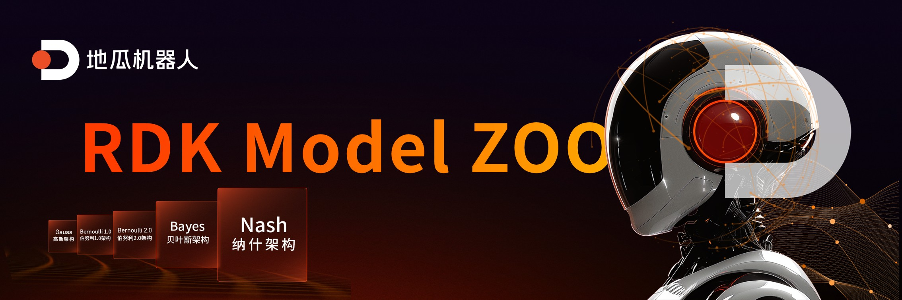
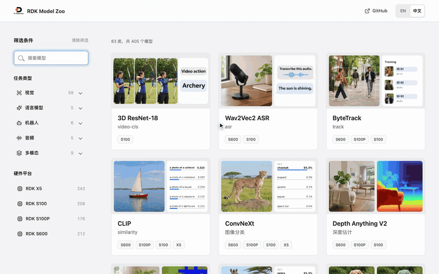
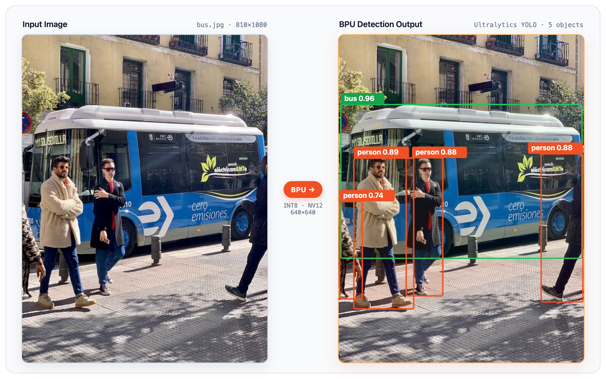
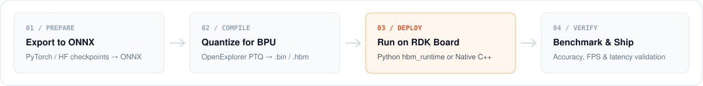

<div align="center">
  

  <h1>RDK Model Zoo</h1>
  <p>基于 D-Robotics BPU 的开箱即用 AI 模型部署与全链路量化示例库</p>

  [English](./README.md) &nbsp;/&nbsp; **简体中文**

  <p align="center">
    <a href="https://d-robotics.github.io/rdk_model_zoo/"></a>
    <a href="https://github.com/D-Robotics/rdk_model_zoo/releases"></a>
    <a href="https://github.com/D-Robotics/rdk_model_zoo/stargazers"></a>
    <a href="./LICENSE"></a>
  </p>

  <p align="center">
    <a href="#web-model-catalog">在线模型目录</a> &nbsp;·&nbsp;
    <a href="#quick-start">快速上手</a> &nbsp;·&nbsp;
    <a href="#how-it-works">工作流程</a> &nbsp;·&nbsp;
    <a href="#hardware-support">支持板卡</a> &nbsp;·&nbsp;
    <a href="#model-list">模型列表</a> &nbsp;·&nbsp;
    <a href="#documentation">文档与工具链</a> &nbsp;·&nbsp;
    <a href="#faq">常见问题</a>
  </p>
</div>

---

<a id="web-model-catalog"></a>
## 简介与在线模型目录

**RDK Model Zoo** 是地瓜机器人（D-Robotics）官方维护的 BPU 模型示例库，把常见的视觉、大模型、语音和机器人模型直接跑在 RDK 开发板的 BPU 上。每个示例都提供预编译模型下载脚本、可直接运行的 Python（`hbm_runtime`）或 C++ 推理代码，以及完整的量化转换教程。

想按板卡或任务快速检索模型、查看实测帧率与精度，或直接复制运行命令，可以打开 **[在线模型目录](https://d-robotics.github.io/rdk_model_zoo/)**：

<a href="https://d-robotics.github.io/rdk_model_zoo/">
  
</a>

<p align="center">
  <a href="https://d-robotics.github.io/rdk_model_zoo/"><b>打开在线模型目录 →</b></a>
</p>

---

<a id="quick-start"></a>
## 快速上手

以 **RDK X5**（`RDK OS >= 3.5.0`）运行 Ultralytics YOLO11x 目标检测为例，只需两步：

```bash
# 1. 下载预编译好的 BPU 模型
cd samples/vision/ultralytics_yolo/model
bash download_model.sh --platform x5 --family yolo11 --task detect --model-size x

# 2. 在开发板上运行推理
cd ../runtime/python
python3 main.py \
  --task detect \
  --platform x5 \
  --family yolo11 \
  --model-size x \
  --test-img ../../test_data/bus.jpg \
  --img-save-path ../../test_data/inference_yolo11x.jpg
```

<div align="center">
  
</div>

> 运行其他板卡或模型前，请先阅读对应目录下的 `README_cn.md` / `README.md`，确认支持的模型制品、C++ 编译方式及参数说明。

---

<a id="how-it-works"></a>
## 工作流程

仓库内所有示例都遵循统一且透明的四步落地链路，从开源权重直达板端部署：

<picture>
  <source media="(prefers-color-scheme: dark)" srcset="docs/assets/pipeline_dark.svg" />
  <source media="(prefers-color-scheme: light)" srcset="docs/assets/pipeline_light.svg" />
  
</picture>

- **一套目录适配全系板卡**：RDK X5 与 S 系列共用同一份 `samples/` 目录，通过 `--target` 或 `--platform` 参数切换目标硬件。
- **支持部署自己的训练模型**：每个示例均附带 ONNX 导出、OpenExplorer 量化编译（`.bin` / `.hbm`）与校准说明。
- **兼顾易读性与高性能**：Python 入口遵循清晰的 `preprocess -> infer -> postprocess` 结构；需要极限吞吐与低时延时可直接使用原生 C++ 入口。

---

<a id="hardware-support"></a>
## 支持板卡与系统

| 板卡 | Target ID | CPU | BPU（INT8） | 已发布制品 |
| :--- | :--- | :--- | :--- | :--- |
| **[RDK X5](https://www.d-robotics.cc/rdkX5)** | `x5` | 8× Cortex-A55 | 1× Bayes-E，10 TOPS | [`docs/release/x5/`](docs/release/x5) |
| **[RDK S100](https://www.d-robotics.cc/rdkS100)** | `s100` | 6× Cortex-A78AE | 1× Nash-E，80 TOPS | [`docs/release/s/`](docs/release/s) |
| **[RDK S100P](https://www.d-robotics.cc/rdkS100)** | `s100p` | 6× Cortex-A78AE | 1× Nash-M，128 TOPS | [`docs/release/s/`](docs/release/s) |
| **[RDK S600](https://www.d-robotics.cc/rdkS600)** | `s600` | 18× Cortex-A78AE | 4× Nash-P，560 TOPS | [`docs/release/s/`](docs/release/s) |

四款板卡均运行 **RDK OS**（RDK X5 推荐使用 `RDK OS >= 3.5.0`；S100/S100P/S600 请使用与已发布制品匹配的板端镜像与运行时）。

**分支说明**：[`main`](https://github.com/D-Robotics/rdk_model_zoo/tree/main) 为稳定交付分支，[`develop`](https://github.com/D-Robotics/rdk_model_zoo/tree/develop) 为统一开发分支；历史分板卡分支保留在 [`rdk_x5`](https://github.com/D-Robotics/rdk_model_zoo/tree/rdk_x5) 与 [`rdk_s`](https://github.com/D-Robotics/rdk_model_zoo/tree/rdk_s)，RDK X3 资料归档于 [`rdk_x3`](https://github.com/D-Robotics/rdk_model_zoo/tree/rdk_x3)。

---

<a id="model-list"></a>
## 模型列表与目录结构

| 领域 | 数量 | 代表模型 | 索引入口 |
| :--- | :---: | :--- | :--- |
| **计算机视觉** | 49 个 | Ultralytics YOLO、MobileSAM、Depth Anything V2、PaddleOCR、CLIP 等 | [`samples/README_cn.md`](./samples/README_cn.md) |
| **大语言模型** | 4 个 | OELLM S600 套件（32 配置）、Gemma4（E2B / E4B）、MiniCPM5-2B | [`samples/llm/`](./samples/llm) |
| **语音处理** | 3 个 | ASR（Wav2Vec2 / XLSR53）、Paraformer、关键词检测（KWS） | [`samples/speech/`](./samples/speech) |
| **具身 VLA** | 2 个 | 上游 ACT 与 Pi0 集成（固定 Git 子模块） | [`samples/vla/README_cn.md`](./samples/vla/README_cn.md) |
| **机器人运控** | 1 个 | HIMLoco 足式机器人运动控制策略（Unitree Go2） | [`samples/robotics/himloco`](./samples/robotics/himloco) |

<details>
<summary><b>展开完整模型列表（按类别与支持平台）</b></summary>

<br>

| 类别 | 模型名称 | 支持平台（RDK） | 模型路径 |
| :--- | :--- | :--- | :--- |
| 视频动作分类 | 3D ResNet | S100 | [`samples/vision/3dresnet`](./samples/vision/3dresnet) |
| 图像分类 | ConvNeXt | X5 | [`samples/vision/convnext`](./samples/vision/convnext) |
| 图像分类 | EdgeNeXt | X5 | [`samples/vision/edgenext`](./samples/vision/edgenext) |
| 图像分类 | EfficientFormer | X5 | [`samples/vision/efficientformer`](./samples/vision/efficientformer) |
| 图像分类 | EfficientFormerV2 | X5 | [`samples/vision/efficientformerv2`](./samples/vision/efficientformerv2) |
| 图像分类 | EfficientNet | X5/S100/S600 | [`samples/vision/efficientnet`](./samples/vision/efficientnet) |
| 图像分类 | EfficientViT | X5 | [`samples/vision/efficientvit`](./samples/vision/efficientvit) |
| 图像分类 | FasterNet | X5 | [`samples/vision/fasternet`](./samples/vision/fasternet) |
| 图像分类 | FastViT | X5 | [`samples/vision/fastvit`](./samples/vision/fastvit) |
| 图像分类 | GoogLeNet | X5 | [`samples/vision/googlenet`](./samples/vision/googlenet) |
| 图像分类 | HGNetV2 | X5 | [`samples/vision/hgnetv2`](./samples/vision/hgnetv2) |
| 图像分类 | MobileNetV1 | X5/S100/S100P/S600 | [`samples/vision/mobilenetv1`](./samples/vision/mobilenetv1) |
| 图像分类 | MobileNetV2 | X5/S100/S100P/S600 | [`samples/vision/mobilenetv2`](./samples/vision/mobilenetv2) |
| 图像分类 | MobileNetV3 | S100/S100P/S600 | [`samples/vision/mobilenetv3`](./samples/vision/mobilenetv3) |
| 图像分类 | MobileNetV4 | X5/S100/S100P/S600 | [`samples/vision/mobilenetv4`](./samples/vision/mobilenetv4) |
| 图像分类 | MobileOne | X5 | [`samples/vision/mobileone`](./samples/vision/mobileone) |
| 图像分类 | RepGhost | X5 | [`samples/vision/repghost`](./samples/vision/repghost) |
| 图像分类 | RepVGG | X5 | [`samples/vision/repvgg`](./samples/vision/repvgg) |
| 图像分类 | RepViT | X5 | [`samples/vision/repvit`](./samples/vision/repvit) |
| 图像分类 | ResNet | X5/S100/S100P/S600 | [`samples/vision/resnet`](./samples/vision/resnet) |
| 图像分类 | ResNeXt | X5 | [`samples/vision/resnext`](./samples/vision/resnext) |
| 图像分类 | VargConvNet | X5 | [`samples/vision/vargconvnet`](./samples/vision/vargconvnet) |
| 图像分类 | ViT | S100 | [`samples/vision/vit`](./samples/vision/vit) |
| 行人重识别 | OSNet x1.0 | X5/S100/S100P/S600 | [`samples/vision/osnet`](./samples/vision/osnet) |
| 多目标跟踪 | ByteTrack | X5/S100/S100P/S600 | [`samples/vision/bytetrack`](./samples/vision/bytetrack) |
| 多目标跟踪 | HobotMot（IOU 2.0） | X5/S100/S100P/S600 | [`samples/vision/hobot_mot`](./samples/vision/hobot_mot) |
| 目标检测 / 行人跟踪 | Faster R-CNN MobileNetV3-Large | X5/S100/S100P/S600 | [`samples/vision/fasterrcnn`](./samples/vision/fasterrcnn) |
| 提示式图像分割 | EfficientSAM-Tiny | X5/S100/S100P/S600 | [`samples/vision/efficient_sam`](./samples/vision/efficient_sam) |
| 提示式图像分割 | MobileSAM | X5/S100/S100P/S600 | [`samples/vision/mobile_sam`](./samples/vision/mobile_sam) |
| 单目深度估计 | Depth Anything V2 | S100 | [`samples/vision/depth_anything_v2`](./samples/vision/depth_anything_v2) |
| 单目深度估计 | YOLO26 Depth | X5/S100/S100P/S600 | [`samples/vision/yolo26_depth`](./samples/vision/yolo26_depth) |
| 语义分割 | PP-LiteSeg | X5 | [`samples/vision/pp_liteseg`](./samples/vision/pp_liteseg) |
| 语义分割 | UNet ResNet 系列 | X5 | [`samples/vision/unet`](./samples/vision/unet) |
| 语义分割 | UNetMobileNet | S100/S600 | [`samples/vision/unetmobilenet`](./samples/vision/unetmobilenet) |
| 车道线检测 | LaneNet | S100 | [`samples/vision/lanenet`](./samples/vision/lanenet) |
| 目标检测 | FCOS | X5 | [`samples/vision/fcos`](./samples/vision/fcos) |
| 目标检测 | YOLOv5 | X5/S100/S600 | [`samples/vision/yolov5`](./samples/vision/yolov5) |
| 视觉多任务 | Ultralytics YOLO（`YOLOv5u–YOLO26`） | X5/S100/S100P/S600 | [`samples/vision/ultralytics_yolo`](./samples/vision/ultralytics_yolo) |
| 免提示实例分割 | YOLOE | X5/S100/S100P | [`samples/vision/yoloe`](./samples/vision/yoloe) |
| 开放词表目标检测 | YOLOWorld | X5 | [`samples/vision/yoloworld`](./samples/vision/yoloworld) |
| 点云分割 | PointNet | S100 | [`samples/vision/pointnet`](./samples/vision/pointnet) |
| 图像抠图 | MODNet | X5 | [`samples/vision/modnet`](./samples/vision/modnet) |
| OCR 检测与识别 | PaddleOCR | X5/S100/S600 | [`samples/vision/paddle_ocr`](./samples/vision/paddle_ocr) |
| 车牌识别 | LPRNet | X5 | [`samples/vision/lprnet`](./samples/vision/lprnet) |
| 图文多模态匹配 | CLIP | X5 | [`samples/vision/clip`](./samples/vision/clip) |
| 视觉特征编码 | DINOv2 | S100/S100P/S600 | [`samples/vision/dinov2`](./samples/vision/dinov2) |
| 视觉-语言编码 | SigLIP | S100/S100P | [`samples/vision/siglip`](./samples/vision/siglip) |
| 音频驱动数字人 | LiteAvatar | S100/S100P/S600 | [`samples/vision/lite_avatar`](./samples/vision/lite_avatar) |
| 语音识别 | ASR（Wav2Vec2 / XLSR53） | S100/S600 | [`samples/speech/asr`](./samples/speech/asr) |
| 关键词检测 | KWS | S100 | [`samples/speech/kws`](./samples/speech/kws) |
| 语音识别 | Paraformer | S100 | [`samples/speech/paraformer`](./samples/speech/paraformer) |
| 端到端规划驾驶 | DiffusionDrive | S100P/S600 | [`samples/vision/diffusiondrive`](./samples/vision/diffusiondrive) |
| 足式机器人运控 | HIMLoco（Unitree Go2） | X5 | [`samples/robotics/himloco`](./samples/robotics/himloco) |
| 多模态大模型套件 | 官方 OELLM 套件（SDK 2.0.0） | S600 | [`samples/llm/oellm`](./samples/llm/oellm) |
| 文本生成 | Gemma4 E2B/E4B（SDK 2.0） | S600 | [`samples/llm/gemma4`](./samples/llm/gemma4) |
| 视觉-语言模型 | Gemma4-E2B（原生 C++） | S100/S100P/S600 | [`samples/llm/gemma4-e2b`](./samples/llm/gemma4-e2b) |
| 文本生成 | MiniCPM5-2B（原生 C++） | S100/S100P/S600 | [`samples/llm/minicpm5-2b`](./samples/llm/minicpm5-2b) |

部分 Sample 为归档或参考实现，或需要本地检测模型、C++ 运行时或自行提供模型文件；具体要求见各 Sample 的支持表。

</details>

<details>
<summary><b>展开仓库目录结构</b></summary>

<br>

```text
rdk_model_zoo/
├── samples/
│   ├── llm/                     # 端侧 LLM 与 VLM 运行时（原生 C++ / OELLM SDK）
│   │   ├── gemma4/              # Gemma4 E2B / E4B 文本生成（OELLM SDK 2.0.0）
│   │   ├── gemma4-e2b/          # Gemma4-E2B 视觉语言对话与 HTTP 服务（原生 C++）
│   │   ├── minicpm5-2b/         # MiniCPM5-2B 文本生成（原生 C++）
│   │   └── oellm/               # 官方 OELLM SDK 2.0.0 S600 模型套件
│   ├── robotics/
│   │   └── himloco/             # Unitree Go2 足式机器人运动控制策略
│   ├── speech/
│   │   ├── asr/                 # 语音识别（Wav2Vec2 / XLSR53）
│   │   ├── kws/                 # 关键词检测
│   │   └── paraformer/          # Paraformer 语音识别
│   ├── vla/                     # 上游 VLA 集成（ACT / Pi0，固定 Git 子模块）
│   └── vision/                  # 49 个计算机视觉与多模态示例
│       ├── 3dresnet/            # 视频动作分类
│       ├── bytetrack/           # 多目标跟踪
│       ├── clip/                # 图文多模态匹配
│       ├── convnext/            # 图像分类
│       ├── depth_anything_v2/   # 单目深度估计
│       ├── diffusiondrive/      # 端到端规划驾驶
│       ├── dinov2/              # 视觉特征编码
│       ├── edgenext/            # 图像分类
│       ├── efficient_sam/       # 提示式图像分割
│       ├── efficientformer/     # 图像分类
│       ├── efficientformerv2/   # 图像分类
│       ├── efficientnet/        # 图像分类
│       ├── efficientvit/        # 图像分类
│       ├── fasterrcnn/          # COCO 检测与行人跟踪
│       ├── fasternet/           # 图像分类
│       ├── fastvit/             # 图像分类
│       ├── fcos/                # 目标检测
│       ├── googlenet/           # 图像分类
│       ├── hgnetv2/             # 图像分类
│       ├── hobot_mot/           # 多目标跟踪（CPU IOU 2.0）
│       ├── lanenet/             # 车道线检测
│       ├── lite_avatar/         # 音频驱动数字人
│       ├── lprnet/              # 车牌识别
│       ├── mobile_sam/          # 提示式图像分割
│       ├── mobilenetv1..v4/     # 图像分类（v1 / v2 / v3 / v4）
│       ├── mobileone/           # 图像分类
│       ├── modnet/              # 图像抠图
│       ├── osnet/               # 行人重识别
│       ├── paddle_ocr/          # OCR 文字检测与识别
│       ├── pointnet/            # 点云部件分割
│       ├── pp_liteseg/          # 语义分割
│       ├── repghost/            # 图像分类
│       ├── repvgg/              # 图像分类
│       ├── repvit/              # 图像分类
│       ├── resnet/              # 图像分类
│       ├── resnext/             # 图像分类
│       ├── siglip/              # 视觉-语言编码
│       ├── ultralytics_yolo/    # 检测 / 分割 / 姿态 / 分类 / 旋转框（YOLOv5u–YOLO26）
│       ├── unet/                # 语义分割
│       ├── unetmobilenet/       # 语义分割
│       ├── vargconvnet/         # 图像分类
│       ├── vit/                 # 图像分类
│       ├── yolo26_depth/        # 单目深度估计
│       ├── yoloe/               # 免提示实例分割
│       ├── yolov5/              # 目标检测
│       └── yoloworld/           # 开放词表目标检测
├── datasets/                    # 示例数据集与下载脚本
├── docs/                        # 工程规范、架构说明、版本制品清单与用户指南
├── skills/                      # RDK Model Zoo Agent Skills 技能包
└── utils/                       # 公共 C++ / Python 工具与维护者校验工具
```

</details>

---

<a id="documentation"></a>
## 文档、工具链与技能

| 分类 | 文档与入口 |
| :--- | :--- |
| **用户手册** | [RDK X 系列用户手册](https://developer.d-robotics.cc/rdk_x_doc/RDK) · [RDK S 系列用户手册](https://developer.d-robotics.cc/rdk_s_doc/RDK) · [Model Zoo 用户手册](https://developer.d-robotics.cc/model_zoo_doc/model_zoo_intro) |
| **算法工具链** | [X5 OE 手册](https://developer.d-robotics.cc/oe_x5_doc/cn/index.html) · [S 系列 OE 手册](https://developer.d-robotics.cc/oe_s_doc/index.html) · [S100 OE LLM 手册](https://developer.d-robotics.cc/oe_llm_s100p_doc/index.html) · [S600 OE LLM 手册](https://developer.d-robotics.cc/oe_llm_doc/index.html) |
| **模型索引** | [在线模型目录](https://d-robotics.github.io/rdk_model_zoo/) · [按任务选择示例](./samples/README_cn.md) · [VLA 总览](./samples/vla/README_cn.md) |
| **开发规范** | [仓库规范指南](./docs/Model_Zoo_Repository_Guidelines.md) · [Runtime 规范](./docs/sample-standards/runtime-code.md) · [README 规范](./docs/sample-standards/readme-contract.md) · [示例架构](./docs/architecture/model-examples.md) |
| **接口与制品** | [源码参考](./docs/source_reference/README_cn.md) · [Python API 指南](./docs/Python_API_User_Guide.md) · [UCP 指南](./docs/UCP_User_Guide.md) · [版本与制品清单](./docs/release) |
| **Agent Skills** | [RDK Model Zoo 技能包](./skills/README_cn.md)（7 个面向 BPU 示例开发、校验、评审与发布的可复用技能） |
| **开发者社区** | [D-Robotics 开发者社区](https://developer.d-robotics.cc/) · [GitHub Issues](https://github.com/D-Robotics/rdk_model_zoo/issues) |

---

<a id="faq"></a>
## 常见问题

<details>
<summary><b>1. 自己训练模型的精度不满足预期？</b></summary>
<br>

- 检查 OpenExplorer Docker 与板端 `libdnn.so` 是否为当前推荐版本。
- 检查模型导出时是否按对应示例 README 的要求完成结构调整或算子替换。
- 检查量化验证阶段各输出节点的余弦相似度是否达到 `0.999` 以上（最低不低于 `0.99`）。
</details>

<details>
<summary><b>2. 自己训练模型的速度不满足预期？</b></summary>
<br>

- Python API 的性能通常低于 C/C++，如需极限性能请优先使用 C/C++。
- Benchmark 数据通常只统计纯前向，不包含前后处理，完整 demo 端到端耗时会更高。
- 使用 **NV12** 输入的模型通常更容易获得最高 BPU 吞吐。
- 请确认板卡 CPU / BPU 已设置为高性能模式，并避免其他进程抢占资源。
</details>

<details>
<summary><b>3. 如何解决模型量化掉精度问题？</b></summary>
<br>

- 请优先参考对应平台工具链文档中的 PTQ 精度调试章节。
- 若模型结构本身对 INT8 敏感，可考虑混合精度（Mixed Precision）或 QAT（量化感知训练）。
</details>

<details>
<summary><b>4. 报错 "Can't reshape 1354752 in (1,3,640,640)" 怎么解决？</b></summary>
<br>

转换配置与 ONNX 输入尺寸不再匹配。请将对应示例 `conversion/` 转换指南中的输入分辨率改为与待转换 ONNX 模型一致，同时删除旧的校准数据并重新生成。
</details>

<details>
<summary><b>5. mAP 精度相比官方结果（如 Ultralytics）偏低是否正常？</b></summary>
<br>

使用相同的数据集、输入分辨率、前处理、阈值和评测脚本比较结果。先检查浮点模型，再用相同输入比较量化模型；前处理对照应包含 RGB/NV12 转换。
</details>

<details>
<summary><b>6. 模型推理时会使用 CPU 吗？</b></summary>
<br>

会。无法量化的算子、无法映射到 BPU 的算子，或量化 / 反量化节点都会由 CPU 执行。即使是以 BPU 为主的 `.bin` 模型，输入输出端通常也会包含 CPU 参与的转换过程。
</details>

---

## 社区与许可证

<a href="https://www.star-history.com/?type=date&repos=D-Robotics%2Frdk_model_zoo">
 <picture>
   <source media="(prefers-color-scheme: dark)" srcset="https://api.star-history.com/chart?repos=D-Robotics%2Frdk_model_zoo&type=date&theme=dark&legend=top-left&sealed_token=pcz2nn9lRITzBL-JyNLEYFdMZf7Ra0ft7FtCA_eTVEsXH_7xk2cX9jbYWg1AT0ilwVvO4VgrNH0vXv3LVHeGq58Yi24r1novjfb7VFH3Gc1GCT2jGjg38g" />
   <source media="(prefers-color-scheme: light)" srcset="https://api.star-history.com/chart?repos=D-Robotics%2Frdk_model_zoo&type=date&legend=top-left&sealed_token=pcz2nn9lRITzBL-JyNLEYFdMZf7Ra0ft7FtCA_eTVEsXH_7xk2cX9jbYWg1AT0ilwVvO4VgrNH0vXv3LVHeGq58Yi24r1novjfb7VFH3Gc1GCT2jGjg38g" />
   
 </picture>
</a>

<br />

欢迎通过 [GitHub Issues](https://github.com/D-Robotics/rdk_model_zoo/issues) 提交问题与 PR，或在 [D-Robotics 开发者社区](https://developer.d-robotics.cc/) 交流。

本项目采用 [Apache License 2.0](./LICENSE) 开源协议。
