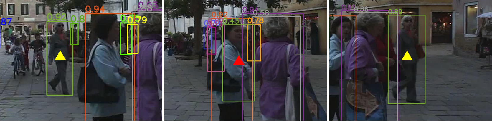
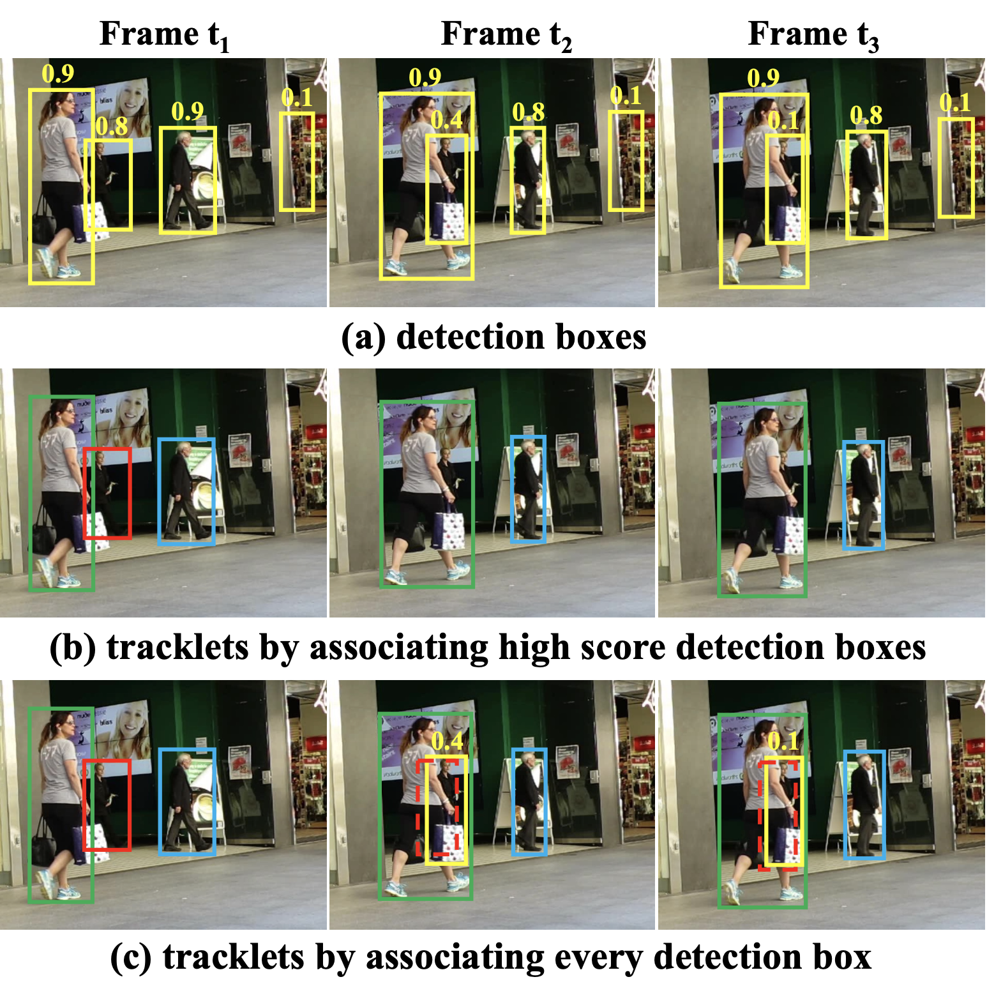

[English](README.md) | 简体中文

# ByteTrack

<a id="overview"></a>
## 算法与来源

ByteTrack 通过关联高置信度和低置信度检测框，在视频帧之间跟踪目标。恢复低分检测有助于在行人被遮挡时保持身份连续。本示例组合 YOLOv5 行人检测器与 CPU BYTETracker。

参考：[ByteTrack: Multi-Object Tracking by Associating Every Detection Box](https://arxiv.org/abs/2110.06864).

<a id="directory"></a>
## 目录结构

```text
bytetrack/
├── conversion/  # 导出与量化配置
├── evaluator/  # 评估程序与指标
├── model/  # 模型文件与下载脚本
├── runtime/  # 推理程序
├── test_data/  # 示例输入
├── README.md  # 英文说明
├── README_cn.md  # 中文说明
└── requirements-host.txt  # Python 依赖
```

<a id="support-matrix"></a>
## 支持矩阵

| 目标 | 变体 | Python | C++ | 说明 |
|---|---|---|---|---|
| S100 | YOLOv5x 672 | 支持 | 支持 | 对应板卡 HBM |
| S100P | YOLOv5x 672 | 支持 | 支持 | 对应板卡 HBM |
| S600 | YOLOv5x 672 | 支持 | 支持 | 对应板卡 HBM |
| X5 | YOLOv5 640，默认 n-v7.0 | 支持 | 支持 | 复用 X5 YOLOv5 `.bin` 模型 |

每路视频使用一个 `ByteTrackTask` 实例，并按视频顺序逐帧处理。切换视频时，调用 `reset()` 清空已有轨迹，帧号从头开始；新目标的 ID 继续递增。

<a id="prerequisites"></a>
## 环境前提

需要 Python 3、NumPy、SciPy、OpenCV、`lap==0.5.12` 和 `cython-bbox==0.1.5`。X5 使用系统镜像提供的 `hbm_runtime` 和 640×640 packed-NV12 `.bin` 模型；S 系列使用 `hbm_runtime` 和 672×672 split-NV12 `.hbm` 模型。准备依赖：

```bash
python3 -m pip install -r samples/vision/bytetrack/requirements-host.txt
```

<a id="quickstart"></a>
## 快速体验

在仓库根目录准备 X5 模型和输入视频，然后运行：

```bash
python3 -m samples.vision.bytetrack.model.download --target x5 --variant n-v7.0
curl -fL 'https://archive.d-robotics.cc/downloads/rdk_model_zoo/rdk_s100/ByteTrack/track_test.mp4' \
  -o samples/vision/bytetrack/test_data/track_test.mp4
python3 -m samples.vision.bytetrack.runtime.python.main \
  --target x5 --variant n-v7.0 \
  --input samples/vision/bytetrack/test_data/track_test.mp4 \
  --output samples/vision/bytetrack/test_data/result_x5.mp4 \
  --records samples/vision/bytetrack/test_data/result_x5.jsonl
```

`--variant` 支持 `n-v7.0`、`s-v7.0`、`m-v7.0`、`l-v7.0`、`x-v7.0`，以及 `s-v2.0`、`m-v2.0`、`l-v2.0`、`x-v2.0`。下载和运行时选择同一个变体。

S100 使用以下命令：

```bash
python3 -m samples.vision.bytetrack.model.download --target s100 \
  --output-dir samples/vision/bytetrack/model
curl -L 'https://archive.d-robotics.cc/downloads/rdk_model_zoo/rdk_s100/ByteTrack/track_test.mp4' \
  -o samples/vision/bytetrack/test_data/track_test.mp4
python3 -m samples.vision.bytetrack.runtime.python.main \
  --target s100 --asset-id s:bytetrack:s100/yolov5x_672x672_nv12.hbm \
  --model-path samples/vision/bytetrack/model/s100/yolov5x_672x672_nv12.hbm \
  --input samples/vision/bytetrack/test_data/track_test.mp4 \
  --output samples/vision/bytetrack/test_data/result_unified.mp4 \
  --records samples/vision/bytetrack/test_data/result_unified.jsonl
```

公开 `track_test.mp4` 的记录 SHA-256 为 `4bbe5bf11fe8967b28a900fd2add4949aba89b62076eaa03d0c55cdf7dd41397`；需要校验完整性时执行 `sha256sum track_test.mp4`（macOS：`shasum -a 256 track_test.mp4`）。成功推理会写出可解码 MP4 和可选逐帧 JSONL，打印帧数并退出 `0`。

<a id="expected-results"></a>
## 预期结果

结果视频会显示行人检测框和目标 ID。每帧的轨迹记录包含目标 ID（`track_id`）、原图坐标（`tlbr`）、置信度（`score`）和帧号。没有检测到行人时，程序仍更新已有轨迹。

行人漏检时，可调低 `--score-thres`；目标短暂遮挡后 ID 容易变化时，可增加 `--track-buffer`。完整参数说明见 [Python 运行说明](runtime/python/README_cn.md#parameters)。

检测器保留 COCO `person` 类别 `0`。BYTETracker 先关联高分框，再用 IoU 将剩余轨迹与低分框关联；只有未匹配的高分框会初始化新轨迹。




<a id="entry-points"></a>
## 入口索引

- [`model/README_cn.md`](./model/README_cn.md)：X5 BIN、S 系列 HBM 与模型准备。
- [`runtime/python/README_cn.md`](./runtime/python/README_cn.md)：Python 接口与命令行参数。
- [`runtime/cpp/README_cn.md`](./runtime/cpp/README_cn.md)：X5/S100/S100P/S600 的 C++ 视频跟踪、主机检测回放、CPU 跟踪接口与线程配置。
- [`conversion/README_cn.md`](./conversion/README_cn.md)：YOLOv5 导出与编译。
- [`evaluator/README_cn.md`](./evaluator/README_cn.md)：评测命令、输出与对照说明。

<a id="historical-performance"></a>
## 性能与资源占用

X5 多人跟踪可使用 [C++ Runtime](runtime/cpp/README_cn.md#x5-cpu-performance)：100 人档单线程平均约 1.91 ms，30 FPS 约占一个 CPU 核心的 5.7%。默认采用单线程，多路应用优先并行独立视频流。检测模型在 BPU 上执行，轨迹预测和关联在 CPU 上执行。以下 Python 数据供选择运行方式时参考。

### 跟踪计算

以下为 2026-10-12 的板端运行数据，仅统计 `BYTETracker.update`。每档使用相同的合成人员运动序列，包含低分检测、遮挡及空帧；预热 100 帧后记录 1200 帧，重复两轮。人数列为生成上限，活跃轨迹列为输出均值。延迟统计合并两轮数据。

| 板卡 | 人数上限 | 平均活跃轨迹 | 平均 / P95 延迟（ms） | CPU 时间（ms/帧） | 30 FPS 单核预算 | 60 FPS 单核预算 |
|---|---:|---:|---:|---:|---:|---:|
| X5 | 5 | 4.6 | 4.46 / 5.29 | 4.43 | 13.3% | 26.6% |
| X5 | 20 | 18.2 | 12.91 / 14.50 | 12.86 | 38.6% | 77.2% |
| X5 | 50 | 44.6 | 30.12 / 33.93 | 30.02 | 90.1% | 180.1% |
| X5 | 100 | 90.7 | 60.51 / 68.04 | 60.34 | 181.0% | 362.0% |
| S100 | 5 | 4.6 | 1.47 / 1.72 | 1.46 | 4.4% | 8.7% |
| S100 | 20 | 18.2 | 3.60 / 4.00 | 3.57 | 10.7% | 21.4% |
| S100 | 50 | 44.6 | 7.63 / 8.64 | 7.58 | 22.7% | 45.5% |
| S100 | 100 | 90.7 | 14.71 / 16.45 | 14.63 | 43.9% | 87.8% |

单核预算 = CPU 毫秒/帧 × FPS ÷ 10，100% 表示占满一个 CPU 核心。超过 100% 时，该配置达不到指定帧率。X5 和 S100 的整机占比分别为单核预算除以 8 和 6。

运行环境：Ubuntu 22.04、Python 3.10.12、NumPy 1.26.4、lap 0.5.13、cython-bbox 0.1.5，BLAS/OpenMP 线程数为 1。X5 使用 SciPy 1.10.1，S100 使用 1.15.3。CPU 频率上限均为 1.5 GHz，采用系统默认调频；S100 部分采样为 1.125 GHz，运行时有后台负载。

跟踪进程内存（RSS）：X5 约 49–63 MiB，S100 约 69–85 MiB，包含 Python 解释器、依赖库、输入序列和计时记录。加载这些内容后的初始占用分别为 46.8 MiB 和 68.9 MiB；各人数档位在同一进程中依次运行。

### 视频处理链路

输入为本 Sample 的 `track_test.mp4`，1280×720、30 FPS。每轮预热 30 帧后处理 300 帧，共两轮；下表为两轮平均耗时。使用默认检测与跟踪阈值，OpenCV `mp4v` 编码并写入结果视频。

| 阶段 | X5：YOLOv5n v7.0 640（ms/帧） | S100：YOLOv5x 672（ms/帧） |
|---|---:|---:|
| 视频解码 | 7.99 | 2.92 |
| 检测预处理 | 2.52 | 2.59 |
| 模型 Runtime 调用 | 22.28 | 24.05 |
| 检测后处理 | 19.55 | 36.78 |
| 行人筛选与跟踪更新 | 6.60 | 3.01 |
| 画框 | 2.50 | 1.36 |
| 视频编码与写入 | 70.56 | 21.31 |
| 合计 | 132.02 | 92.03 |

X5 和 S100 的平均活跃轨迹分别为 5.72 和 10.94，使用的检测模型如表头所示。包含视频输出时，处理速度分别约为 7.5 FPS 和 10.8 FPS。进程 CPU 占用分别约为单核的 125% 和 104%，折算整机占比为 15.7% 和 17.4%。CPU 占用包含编码器收尾，表中分段耗时统计逐帧处理。处理帧期间的 RSS 峰值分别为 146.9 MiB 和 163.9 MiB，进程全程峰值为 146.9 MiB 和 191.6 MiB，包含检测、跟踪及视频读写。

X5 使用 HBRT 3.15.55.0，模型构建版本为 3.15.54.0；S100 使用 UCP 3.13.6。模型与 SDK 版本会影响运行表现。

### CPU 与 BPU 分工

本示例在 BPU 上运行 YOLOv5 检测，在 CPU 上完成轨迹预测和目标关联。

多人或多路视频可使用 [C++ 运行程序](runtime/cpp/README_cn.md)。每路视频创建独立的跟踪器，默认使用 `--threads 1`。只需要轨迹记录时，C++ 命令省略 `--output` 即可关闭画框和视频编码。

<a id="license"></a>
## 许可

仓库脚本采用 Apache-2.0 许可。ByteTrack 跟踪源码及模型权重遵循各自的上游许可；跟踪源码来源见 [`runtime/python/TRACKER_SOURCE_MAP.json`](./runtime/python/TRACKER_SOURCE_MAP.json)。
