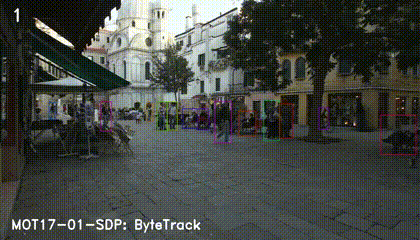
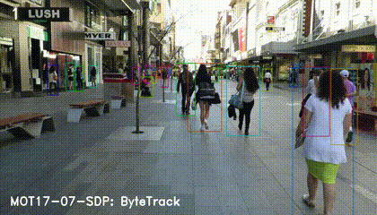

English | [简体中文](README_cn.md)

# ByteTrack evaluator

<a id="dataset"></a>
## Dataset

This tool compares detection and tracking outputs from two implementations using the same model and video. Download the example video from the [quickstart](../README.md#quickstart), or use your own video.

<a id="directory"></a>
## Directory structure

```text
evaluator/
├── README.md  # English instructions
├── README_cn.md  # Chinese instructions
├── capture.py  # Record per-frame inference and tracks
└── compare.py  # Compare two runs
```

<a id="environment"></a>
## Environment

Use an S-series board with a prepared HBM model and video, plus `hbm_runtime`, OpenCV, NumPy, SciPy, `lap==0.5.12`, and `cython-bbox==0.1.5`.

<a id="command"></a>
## Evaluation command

After preparing the model and video, run from the repository root. Choose a new directory for `--output-dir`:

```bash
python3 samples/vision/bytetrack/evaluator/compare.py \
  --target s100 \
  --asset-id s:bytetrack:s100/yolov5x_672x672_nv12.hbm \
  --model-path samples/vision/bytetrack/model/s100/yolov5x_672x672_nv12.hbm \
  --input samples/vision/bytetrack/test_data/track_test.mp4 \
  --output-dir /tmp/bytetrack-comparison \
  --max-frames 30
```

The tool runs the current implementation (`unified`) and the original S-series implementation (`legacy`). It reads the original implementation from Git history. For a shallow clone, fetch the required commit first:

```bash
git fetch origin d2d2a4e0a898697bdfe5f68a9740a8c7d7cad57d
```

Results are saved under `unified/` and `legacy/`, with the comparison in `comparison.json`. The exit code is `0` when all comparisons pass.

<a id="metrics"></a>
## Metrics

Comparison criteria:

| Item | Requirement |
|---|---|
| Input frames, model inputs, track IDs | Exact match |
| Model outputs | Matching shape and dtype, `rtol=0, atol=1e-5` |
| Track coordinates | `atol=1e-4` |
| Track confidence | `atol=1e-5` |

Frames without detections are included. NaN or infinite values are reported as errors.

<a id="outputs"></a>
## Outputs

Each run saves frame images, model inputs, and outputs as `.npy` files. `capture.json` contains tracks and model/video information. `comparison.json` summarizes the comparison; failed runs retain error logs.

<a id="reference-results"></a>
## Reference results

| Reference | Condition | Value | Source |
|---|---|---:|---|
| ByteTrack paper MOTA | MOT17 test / V100 | 80.3 | paper |
| ByteTrack paper IDF1 | MOT17 test / V100 | 77.3 | paper |
| ByteTrack paper throughput | V100 GPU | about 30 FPS | paper |

### Reference tracking effects

These animations show ByteTrack on two MOT17 sequences:



MOT17-01-SDP.



MOT17-07-SDP.

### Tracking parameters

- `--score-thres` (default `0.25`): detector confidence threshold. Lower it when people are missed.
- `--track-thresh` (default `0.3`): high-score detection threshold. High-score boxes are matched first; boxes with scores between `0.1` and this threshold enter a second matching step. An unmatched box can start a track when its score reaches `track_thresh + 0.1`.
- `--match-thresh` (default `0.8`): maximum cost for the first matching step. Larger values accept less overlap; smaller values require closer boxes. Matching combines IoU and confidence by default; `--mot20` uses IoU alone. The second matching step uses a cost limit of `0.5`.
- `--track-buffer` (default `60`): how long to retain a lost track, expressed in frames at 30 FPS. The actual frame count scales with `--frame-rate` (default `30`).

This sample tracks COCO persons (class `0`). To track multiple classes, create a separate tracker for each class.

<a id="boundaries"></a>
## Scope

Both runs use the same model file and video on the same board. The tool compares outputs; it does not calculate dataset accuracy metrics such as MOTA or IDF1.
