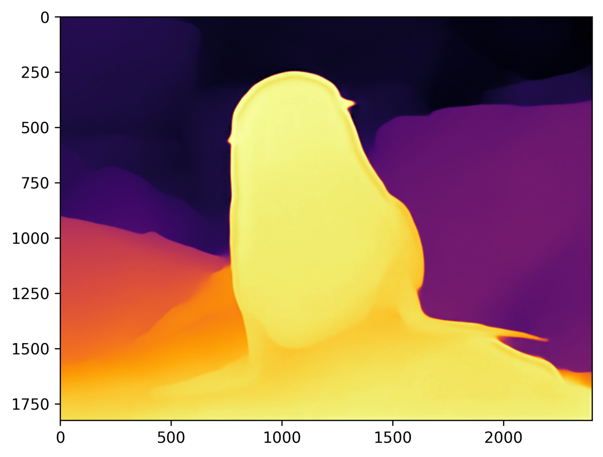
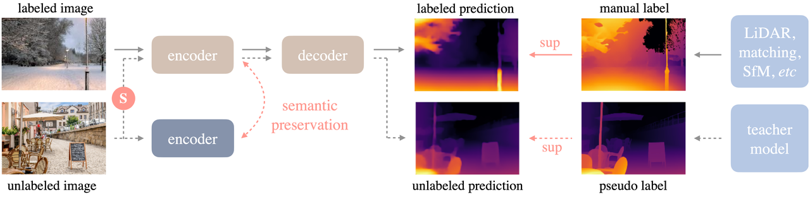

English | [简体中文](README_cn.md)

# Depth Anything V2

<a id="overview"></a>
## Overview

Depth Anything V2 estimates dense relative depth from a single image. It uses synthetic labeled images, a larger teacher and pseudo-labeled real images to improve fine detail. This sample provides inference and depth visualization on RDK S100.

References: [project](https://depth-anything.github.io/), [paper](https://arxiv.org/abs/2406.19675), [upstream repository](https://github.com/DepthAnything/Depth-Anything-V2).

<a id="directory"></a>
## Directory structure

```text
depth_anything_v2/
├── conversion/  # Export and quantization configuration
├── evaluator/  # Evaluation commands and metrics
├── model/  # Model files and download scripts
├── runtime/  # Python and native inference implementations
├── test_data/  # Example inputs
├── README.md  # English instructions
└── README_cn.md  # Chinese instructions
```

<a id="support-matrix"></a>
## Support matrix

| Target | Published artifact | Implementation |
| --- | --- | --- |
| S100 | `s100/depth_any.hbm`; publisher digest unknown | Python |
| S100 Small O1 | `s100/depth_anything_v2_small_518x686_nashe_20261102_o1.hbm`; host ABI checked; board `not-run` | Python |
| S100P | no separate manifest asset | explicitly refused |
| S600 / X5 | no manifest asset | explicitly refused |

No C++ implementation is provided. Internal int16 quantization does not change
the public tensor contract: RGB float32 input `[1,3,518,686]` and float32 depth
output `[1,518,686]`; tensor metadata is checked at load.

<a id="prerequisites"></a>
## Prerequisites

Use an S100 Linux image with compatible vendor `hbm_runtime`, Python, NumPy,
OpenCV and PyYAML. Host inspection needs no SDK. Runtime does not install
packages or download a model; prepare these explicitly. Legacy restoration uses OpenCV
linear interpolation (the source used Torch for this step) and matches the
Torch result up to floating-point rounding — see [runtime contracts](runtime/python/README.md).

<a id="quickstart"></a>
## Quick start

From repository root, inspect without a model or board:

```bash
python -m samples.vision.depth_anything_v2.runtime.python.main --list-models
python -m samples.vision.depth_anything_v2.runtime.python.main --target s100 --dry-run
```

Prepare explicitly, then run on the actual S100:

```bash
bash samples/vision/depth_anything_v2/model/download.sh --target s100
bash samples/vision/depth_anything_v2/runtime/python/run.sh --target s100 \
  --output outputs/depth-anything-s100
```

The helper resolves relative user paths from repository root. The output
directory must not exist. Default input is the bundled `furseal.jpg`. Optional
`--img-save-path result.jpg` adds a source-style color image; it must also be new.
`auto` selects the legacy S100 asset, but execution still verifies the local board.
Assigning an S100 filename does not make S100P compatible.

<a id="expected-results"></a>
## Expected results

A successful run writes `raw_depth.npy`, `depth_native.npy`, `depth_gray.png`,
`depth_color.png` and `report.json`. The report binds local model/input hashes,
selection, runtime metadata and preprocessing policy. It measures no latency.
Unknown publisher hash/runtime version remain unknown.



Color normalization is per image; similar colors across images do not imply
equal depth. A constant map yields zero grayscale instead of division by zero.

Default legacy preprocessing is pixelwise RGB z-score (not the ImageNet constants mentioned in
the original docstring). Default resize is nearest-neighbor stretch. Optional
letterbox uses linear resize/fill-127 and crops the padding before restoring
the result. The task returns float depth; the uint8 display API is a separate
visualization step.

Depth values are relative quantities. The CLI saves original-size float depth and an INFERNO color rendering.



<a id="entry-points"></a>
## Entry points

Start with the commands above, then the runtime guide's API and stage table.
The conversion page records the source ONNX/quantization facts and the missing
recipe prerequisites; the evaluator page records the source performance record.

<a id="license"></a>
## License

Sample code uses the repository [Apache 2.0 license](../../../LICENSE).
Upstream weights, training data and compiled artifacts retain their own applicable
terms; this page does not grant additional rights to them.


The independent public Small workflow and its fixed ImageNet-normalized input are documented in [conversion](conversion/README.md#public-small-518x686-conversion-2026-11-02). Its optional `--variant small-518x686-o1` binding requires a matching manifest entry; the historical model remains the default. All board validation for this new workflow is `not-run`.

Explicitly select the converted public Small O1 once its manifest asset is present:

```bash
bash samples/vision/depth_anything_v2/model/download.sh --target s100 --variant small-518x686-o1
bash samples/vision/depth_anything_v2/runtime/python/run.sh --target s100 \
  --variant small-518x686-o1 --output outputs/depth_anything_v2_small_o1
```

<!-- converted-all-20261103 -->

## Converted S profiles (2026-11-03)

Independent converted profiles and explicit commands are listed in [model preparation](model/README.md). Board accuracy and performance are not measured yet.
