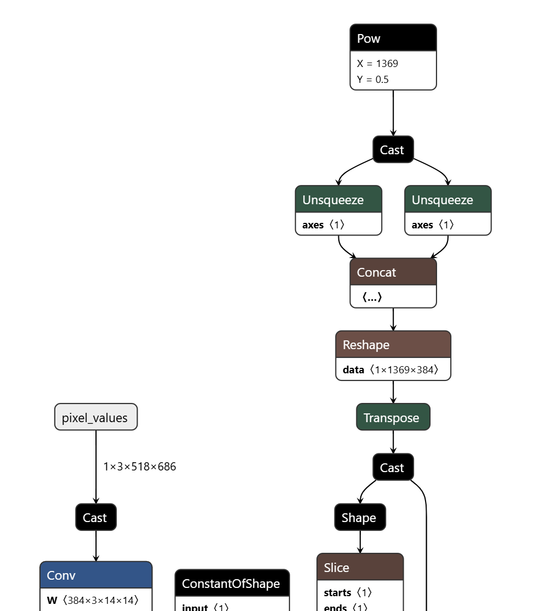
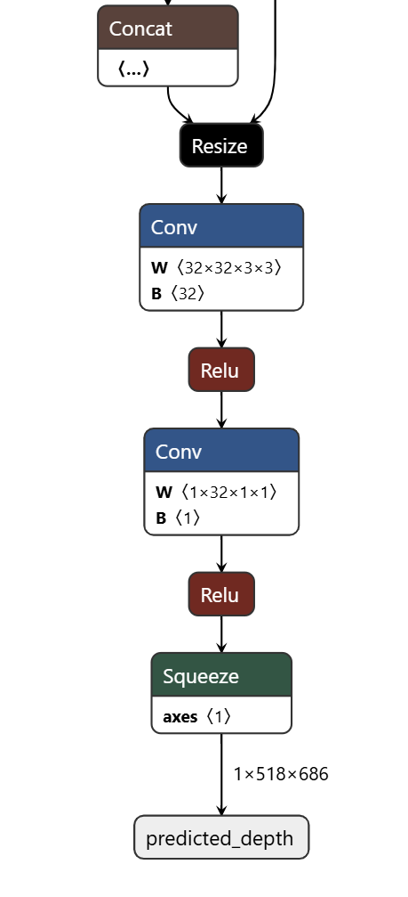
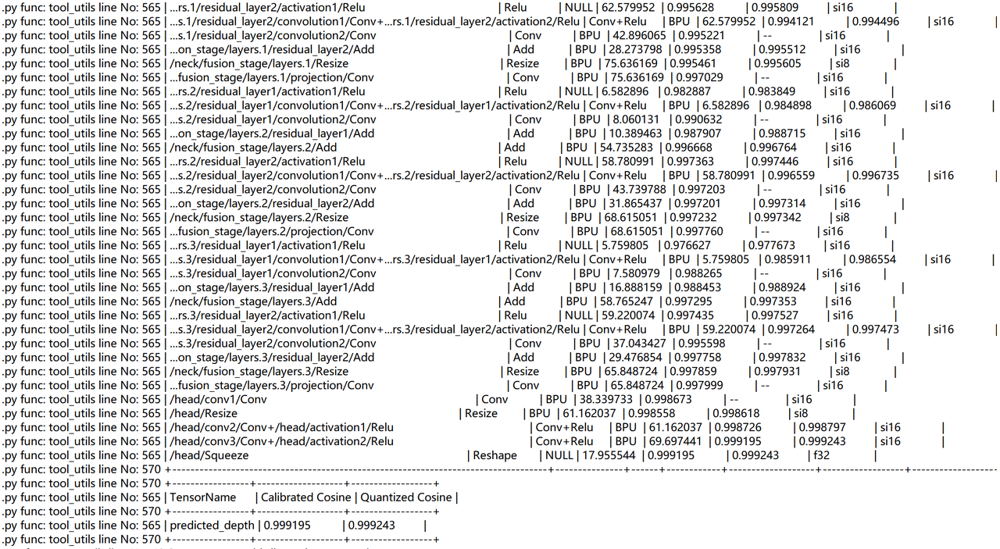

English | [简体中文](README_cn.md)

# Conversion record and missing prerequisites

<a id="source-model"></a>
## Source model

Prepare the checkpoint and encoder version matching `depth_any.hbm`, the upstream revision and an ONNX exporter before conversion. This directory provides graph diagrams and conversion settings; checkpoint files and executable export scripts must be obtained separately.

<a id="directory"></a>
## Directory structure

```text
conversion/
├── README.md  # English instructions
└── README_cn.md  # Chinese instructions
```

<a id="toolchain-targets"></a>
## Toolchain and targets

The source names S100 OpenExplore on an x86 Linux host and int16 quantization.
It does not pin the Docker image/package/compiler versions. Reference entries:
[OE environment](https://developer.d-robotics.cc/rdk_doc/rdk_s/Advanced_development/toolchain_development/overview)
and [toolchain manual](https://toolchain.d-robotics.cc/). Only the S100 artifact is
published in the manifest; the source documentation names S100P but the manifest
carries no separate asset. Do not relabel the S100 artifact for S100P/S600.

<a id="export"></a>
## Recorded ONNX boundary

Input is RGB NCHW `[1,3,518,686]`; output is depth `[1,518,686]`.
The runtime expects float32 public IO. The source graph contains Add, Conv, Mul,
MatMul and attention-related Softmax; these facts do not specify export options.




No export command is supplied because its weights, code and options are missing.
Once obtained, inspect names, layouts, dynamic axes and normalization boundaries
against the runtime binding before compilation.

<a id="calibration"></a>
## Calibration

Prepare representative calibration images and record the sample count, random seed and preprocessing settings. The runtime stretches with nearest-neighbor interpolation and applies per-pixel RGB z-score normalization with epsilon `1e-5`. Match the calibration transform to the exported model and apply normalization once. Letterbox uses a separate geometry protocol.

<a id="compile"></a>
## Compilation

Prepare the compiler version, march, ONNX, input layout and type, normalization settings, calibration set and quantization configuration before compilation. Compiler YAML and launch scripts are external prerequisites. Save the tool logs and model digests with the generated artifact.

<a id="validation"></a>
## Validation and source-recorded similarity

The source reports most operator similarities above.99 and final quantization
similarity about.999; the statistic, dataset and reproducible raw logs are not
supplied. This is a quantization similarity record, not a dataset depth accuracy.



A real reproduction needs matching float/quantized inputs, raw output shape and
values, explicit relative-depth metrics and software/artifact identity. Compare
float arrays before per-image display normalization. Internal int16 quantization
cannot be used to infer the exposed output dtype.

<a id="artifacts"></a>
## Artifact

The existing manifest artifact is `model/s100/depth_any.hbm`, with unknown publisher
SHA-256. Use the [model guide](../model/README.md) for explicit download and path
selection. Local hashes identify the downloaded bytes; the publisher SHA-256 remains unknown.
Generated models must be bound to their actual metadata; identical filenames do
not establish compatible normalization, layout or depth semantics.

<a id="known-gaps"></a>
## Additional preparation

Missing: checkpoint/encoder identity, upstream revision, export code/options,
ONNX checksum, calibration dataset/transform, compiler image/version, compile
configuration, raw similarity logs and real board validation. Collecting these
inputs is the prerequisite for a reproducible recipe. No C++ conversion path or
extra target is provided.
