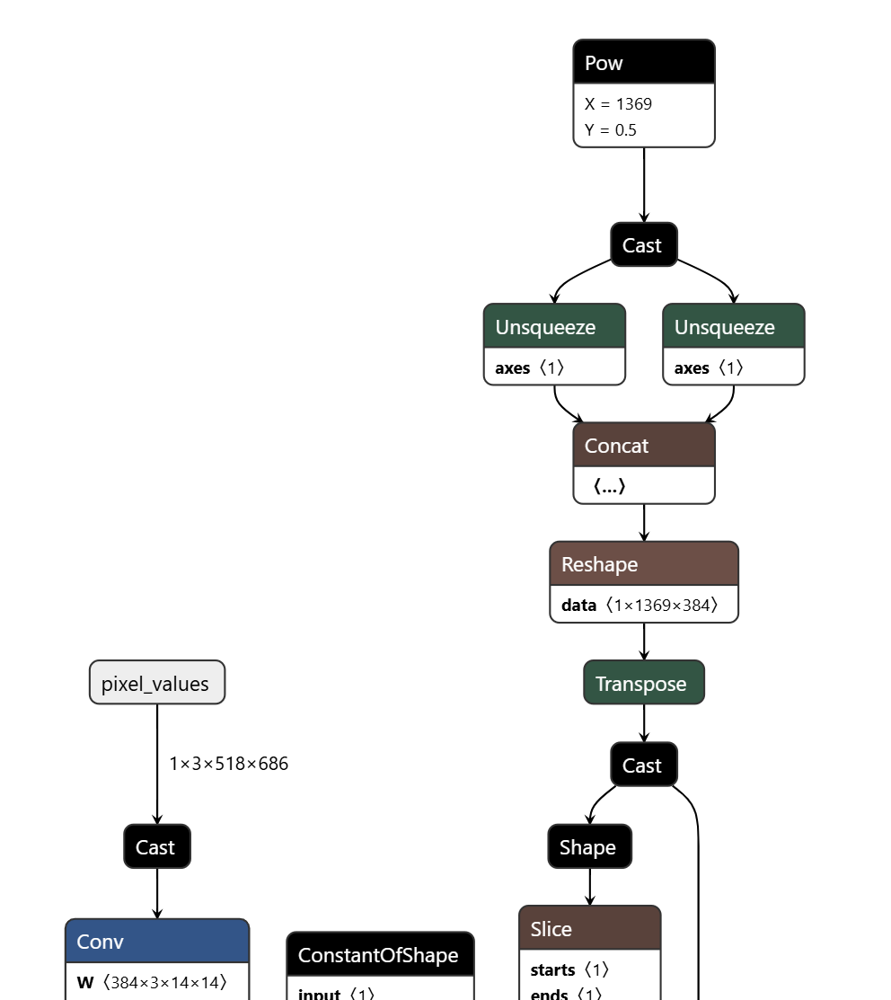
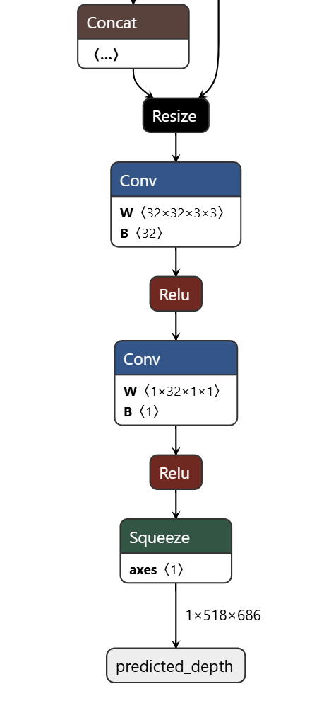
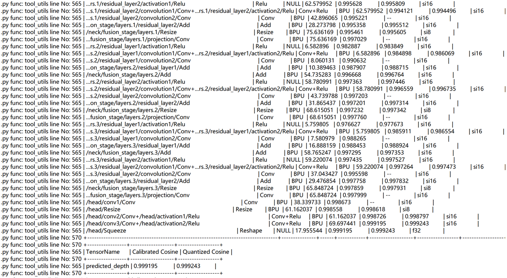

English | [简体中文](README_cn.md)

# Conversion — historical record and public Small

<a id="source-model"></a>
## Source model

The historical `depth_any.hbm` still lacks its matching checkpoint/encoder identity, source revision and exporter. The sections below retain that source record; the independent, pinned public Small workflow follows at the end of this page.

<a id="directory"></a>
## Directory structure

```text
conversion/
├── export_small.py  # Pinned public Small export and host parity
├── prepare_calibration.py  # Verified image-to-tensor preparation
├── recipes/  # Small S100 PTQ configuration
├── licenses/  # Preserved upstream license
├── small_518x686_o1.provenance.json  # Verified O1 conversion identity
├── UPSTREAM_NOTICE.md  # Public Small source and weight identity
├── README.md  # English instructions
└── README_cn.md  # Chinese instructions
```

<a id="toolchain-targets"></a>
## Toolchain and targets

The source names S100 OpenExplore on an x86 Linux host and int16 quantization.
It does not pin the Docker image/package/compiler versions. Reference entries:
[OE environment](https://developer.d-robotics.cc/rdk_doc/rdk_s/Advanced_development/toolchain_development/overview)
and [toolchain manual](https://toolchain.d-robotics.cc/). Only the S100 artifact is
published in the manifest; the source documentation names S100P but the manifest
carries no separate asset. Do not relabel the S100 artifact for S100P/S600.

<a id="export"></a>
## Recorded ONNX boundary

Input is RGB NCHW `[1,3,518,686]`; output is depth `[1,518,686]`.
The runtime expects float32 public IO. The source graph contains Add, Conv, Mul,
MatMul and attention-related Softmax; these facts do not specify export options.




No reproduction command is supplied for the historical artifact because its weights, code and options are missing.
Once obtained, inspect names, layouts, dynamic axes and normalization boundaries
against the runtime binding before compilation.

<a id="calibration"></a>
## Calibration

Prepare representative calibration images and record the sample count, random seed and preprocessing settings. The runtime stretches with nearest-neighbor interpolation and applies per-pixel RGB z-score normalization with epsilon `1e-5`. Match the calibration transform to the exported model and apply normalization once. Letterbox uses a separate geometry protocol.

<a id="compile"></a>
## Compilation

Prepare the compiler version, march, ONNX, input layout and type, normalization settings, calibration set and quantization configuration before compilation. For the historical artifact, compiler YAML and launch scripts remain external prerequisites. Save the tool logs and model digests with the generated artifact.

<a id="validation"></a>
## Validation and source-recorded similarity

The source reports most operator similarities above.99 and final quantization
similarity about.999; the statistic, dataset and reproducible raw logs are not
supplied. This is a quantization similarity record, not a dataset depth accuracy.



A real reproduction needs matching float/quantized inputs, raw output shape and
values, explicit relative-depth metrics and software/artifact identity. Compare
float arrays before per-image display normalization. Internal int16 quantization
cannot be used to infer the exposed output dtype.

<a id="artifacts"></a>
## Artifact

The existing manifest artifact is `model/s100/depth_any.hbm`, with unknown publisher
SHA-256. Use the [model guide](../model/README.md) for explicit download and path
selection. Local hashes identify the downloaded bytes; the publisher SHA-256 remains unknown.
Generated models must be bound to their actual metadata; identical filenames do
not establish compatible normalization, layout or depth semantics.

<a id="known-gaps"></a>
## Additional preparation

Still missing for `depth_any.hbm`: checkpoint/encoder identity, upstream revision, export code/options,
ONNX checksum, calibration dataset/transform, compiler image/version, compile
configuration, raw similarity logs and real board validation. Collecting these
inputs is the prerequisite for a reproducible recipe. No C++ conversion path or
extra target is provided.


## Public Small 518x686 conversion (2026-11-02)

The independent public Small graph uses the official Small (`vits`) checkpoint. It does not identify or reproduce the historical `depth_any.hbm`. Source: [pinned upstream](https://github.com/DepthAnything/Depth-Anything-V2/tree/a561b849ebae10a6f5ef49e26c83cbbcd36c71bf); checkpoint: [fixed Hugging Face revision](https://huggingface.co/depth-anything/Depth-Anything-V2-Small/tree/03876f8651c73a60fe4c2c48294e09fcb6838fcf). Small code and weights use Apache-2.0; Base/Large/Giant terms must not be inferred from this record. Retain the upstream LICENSE with the external checkout.

The checkpoint SHA-256 is `715fade13be8f229f8a70cc02066f656f2423a59effd0579197bbf57860e1378`. `export_small.py` checks it and the source commit, loads the state dict strictly, exports static opset-17 ONNX and compares finite PyTorch/ORT outputs on one real image plus seed-42 random input. No graph rewrite is applied. The ONNX boundary is RGB normalized float32 `[1,3,518,686]` to relative float32 depth `[1,518,686]`. Fixed cubic stretch is an explicit deployment geometry; upstream's variable-size aspect-preserving `infer_image` is not the exported graph.

Using an already provisioned host environment, prepare a new run directory:

```bash
python samples/vision/depth_anything_v2/conversion/export_small.py \
  --source /work/Depth-Anything-V2 --checkpoint /work/depth_anything_v2_vits.pth \
  --image /work/calibration/000000004478.jpg --output-dir /work/depth-run/output/export
python samples/vision/depth_anything_v2/conversion/prepare_calibration.py \
  --images /work/calibration --output-dir /work/depth-run/input/calibration
cp samples/vision/depth_anything_v2/conversion/recipes/small_518x686_nashe_o1.yaml \
  /work/depth-run/input/compile.yaml
```

The image directory must contain the verified source `manifest.json` (`count`, `seed`, `dataset`, and `images` with name/SHA-256). Calibration uses each image's decoded BGR pixels: RGB float64 /255, cubic stretch to 518x686, ImageNet mean `[0.485,0.456,0.406]` and std `[0.229,0.224,0.225]`, then float32 NCHW. The producer stores input and tensor hashes; no classification tensors are reused.

Start the already provisioned S-series image with the new run directory mounted:

```bash
docker run --rm -it --gpus all --cpus 4 --memory 24g --network none \
  -v /work/depth-run:/work/depth-run -w /work/depth-run \
  --entrypoint /bin/bash \
  registry.d-robotics.cc/deliver/ai_toolchain_ubuntu_22_s100_s600_gpu:v3.7.0
```

Inside that container, retain the generated full template and compile the portable O1 recipe:

```bash
export HBTL_THREAD_NUM=2
export OMP_WAIT_POLICY=PASSIVE GOMP_SPINCOUNT=0
export OMP_NUM_THREADS=2 MKL_NUM_THREADS=2 OPENBLAS_NUM_THREADS=2
export NVIDIA_TF32_OVERRIDE=0
hb_config_generator -f -m output/export/depth_anything_v2_small_518x686.onnx --march nash-e
# The portable O1 YAML was copied into this new run above.
hb_compile -c input/compile.yaml
hb_model_info output/compiled/depth_anything_v2_small_518x686_nashe_20261102_o1.hbm
```

The independent O1 recipe uses featuremap input/output with normalization outside the graph, internal int16, nash-e, O1, and two compiler jobs. Its output prefix ends in `_o1`. The original `small_518x686_nashe.yaml` remains the O2 attempt recipe; that attempt was stopped unfinished and does not represent a published artifact. Generated template, effective config, actual image ID, compiler exit/logs, final HBM metadata and OE outputs are separate evidence. A successful float export or checker is not a converted HBM. Board inference, accuracy and performance remain `not-run`.

The validated export environment was Torch 2.8.0+cu128, ONNX 1.17.0, ORT 1.19.2, NumPy 2.2.6 and OpenCV 4.11.0. The S toolchain reports HMCT 2.6.5, HBDK 4.7.5 and hb_compile 3.5.3. For the cached GPU image `registry.d-robotics.cc/deliver/ai_toolchain_ubuntu_22_s100_s600_gpu:v3.7.0`, map the GPU explicitly and set `NVIDIA_TF32_OVERRIDE=0` before starting the process. On the checked RTX 3070, default TF32 exceeded the host float parity tolerance; disabling it passed the unchanged `rtol=atol=1e-3` test. This is a host math-mode setting, not a change to the internal int16 recipe. Both probe results are retained in the run record.

The exporter runs the independent ONNX checker; full `hb_compile -c` also validates its model and input configuration before PTQ. Standalone `hb_compile -m ... --march nash-e` is an additional diagnostic using fixed random thresholds, not the real calibration run. Its incomplete result must remain separate from the full compiler result.

For this host conversion, allocate 24 GiB memory and four CPU cores to the GPU toolchain container, with `--gpus all`. Set the environment above before starting the tools. The installed HBTL context was measured to use 16 threads by default even with `OMP_NUM_THREADS=2`; `HBTL_THREAD_NUM=2` was verified to set its actual thread count to 2. The tested `PASSIVE`/zero-spin settings and disabled TF32 are retained. In the preserved run, 8 GiB caused a host-memory OOM after calibration; the 24 GiB run completed that stage. Cached PTQ recovery belongs to conversion evidence; normal model download and native inference use the regular sample commands.

The commands above rebuild from source export and real image calibration; no private BC cache is required. In the preserved development run, the O2 backend attempt was explicitly superseded after its PTQ and native NodeInfo completed. The independent O1 attempt loads the byte-identical converted BC through the official BC compile entry. Only backend `opt: 2 -> 1` and the output prefix changed; the 200-image quantization and one-image host comparison remain attributed to their original runs. O1 HBM compilation, actual public ABI and OE report acceptance passed; board accuracy and performance remain `not-run`. Source identities and hashes are recorded in [small_518x686_o1.provenance.json](small_518x686_o1.provenance.json).

<!-- converted-all-20261103 -->

## Converted S profiles (2026-11-03)

Each target uses its own PTQ, BC, full NodeInfo and final OE. Internal INT16 settings do not determine the public ABI; these profiles bind the observed float32 outputs. Recipes and hashes are in [converted_targets_20261103.json](converted_targets_20261103.json).

- `s100p / small-518x686-int16-20261103-o1 / model`: [small_518x686_int16_20261103_o1_s100p_model.yaml](recipes/small_518x686_int16_20261103_o1_s100p_model.yaml)
- `s600 / small-518x686-int16-20261103-o1 / model`: [small_518x686_int16_20261103_o1_s600_model.yaml](recipes/small_518x686_int16_20261103_o1_s600_model.yaml)

The original float tolerances, real inputs and checkpoint identity are retained. Compiler estimates and first-calibration-input NodeInfo diagnostics are separate from dataset accuracy and board performance.
