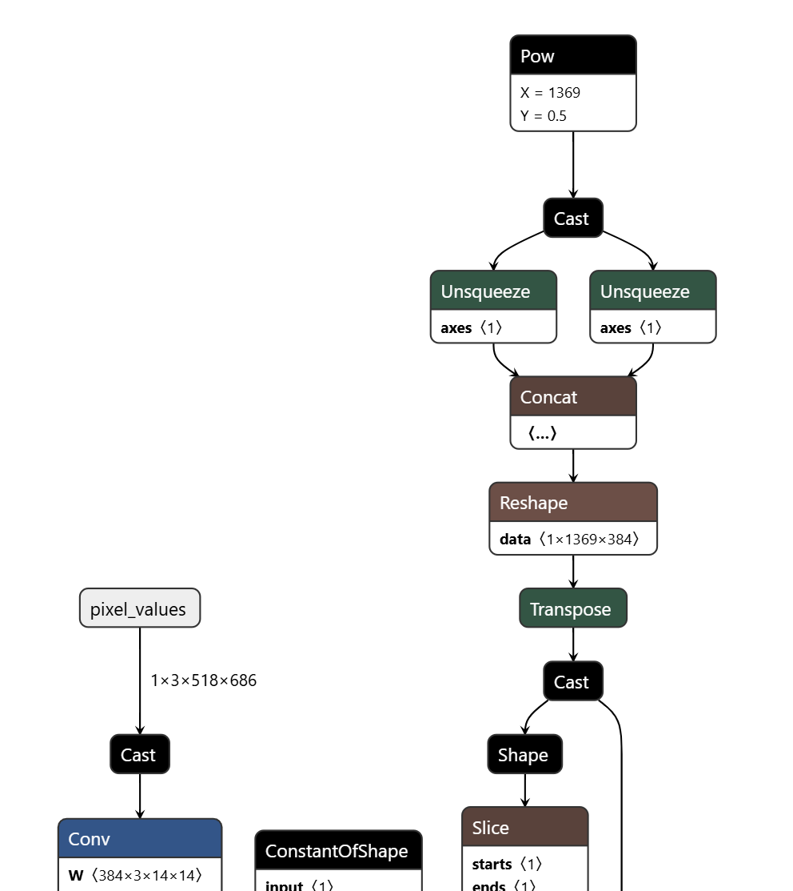
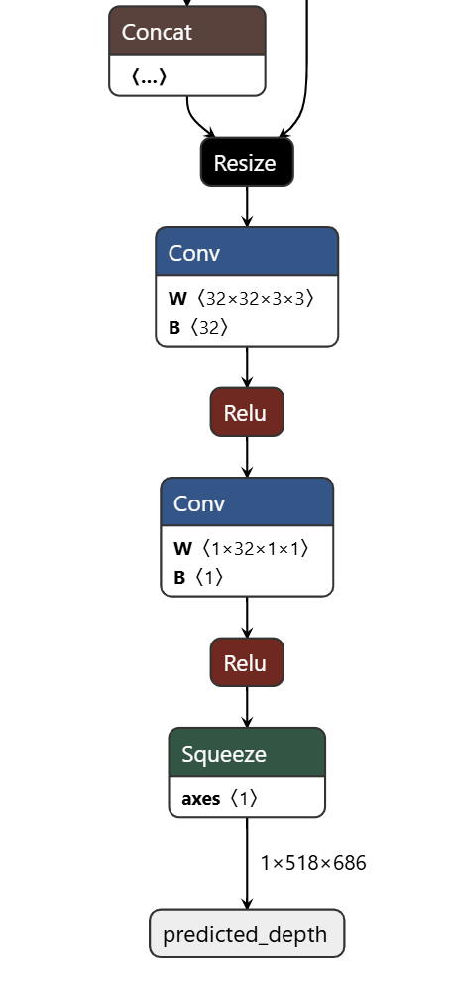
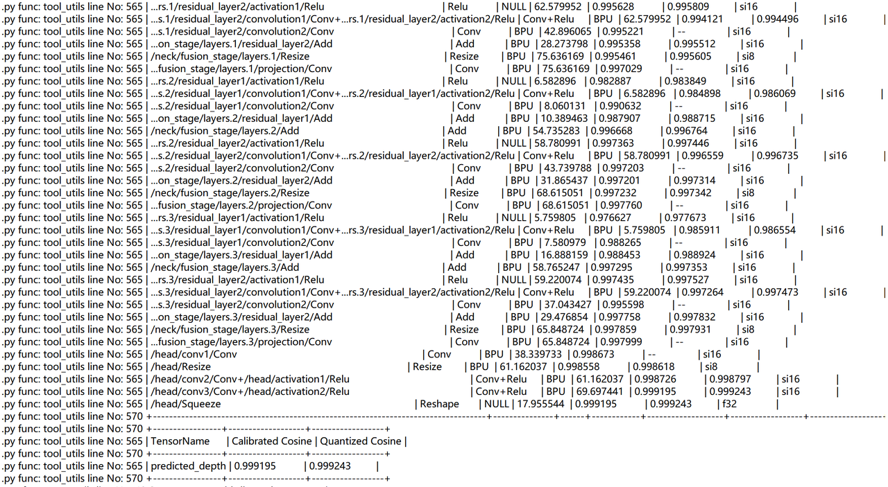

[English](README.md) | 简体中文

# 转换：历史记录与公开 Small

<a id="source-model"></a>
## 源模型

历史 `depth_any.hbm` 仍缺匹配的权重/编码器身份、上游版本及导出脚本。下面保留其来源记录；本页末尾另列固定身份的公开 Small 独立转换流程。

<a id="directory"></a>
## 目录结构

```text
conversion/
├── export_small.py  # 固定公开 Small 导出与主机数值对照
├── prepare_calibration.py  # 已核验图片转校准张量
├── recipes/  # Small S100 PTQ 配置
├── licenses/  # 上游许可证
├── small_518x686_o1.provenance.json  # Verified O1 conversion identity
├── UPSTREAM_NOTICE.md  # Small 源码与权重身份
├── README.md  # 英文说明
└── README_cn.md  # 中文说明
```

<a id="toolchain-targets"></a>
## 工具链与目标

源说明使用 x86 Linux 上的 S100 OpenExplore 和 int16 量化，没有固定 Docker、
开发包或编译器版本。参考入口：[OE 环境](https://developer.d-robotics.cc/rdk_doc/rdk_s/Advanced_development/toolchain_development/overview)
和[工具链手册](https://toolchain.d-robotics.cc/)。清单仅发布 S100 制品；源文档
提到 S100P，但清单没有独立制品，不应把该文件重新标为 S100P/S600。

<a id="export"></a>
## 已记录的 ONNX 边界

输入 RGB NCHW `[1,3,518,686]`，输出深度 `[1,518,686]`。运行时要求公开 IO 为
float32。源图包含 Add、Conv、Mul、MatMul 和注意力中的 Softmax，但这些事实
不能确定导出选项。




历史制品的权重、代码和导出选项缺失，故不提供其复现命令。取得后应先核对名称、布局、动态轴
和归一化边界是否符合运行时绑定，再编译。

<a id="calibration"></a>
## 校准

源未提供校准图片、数量、随机种子、变换脚本或前处理配置。运行时实际先最近邻
拉伸，再按像素 RGB 做 epsilon1e-5 的 z-score，注释所说的 ImageNet 均值不符。
校准配方本身未随附；使用前确认校准数据是否已含同一归一化，避免二次处理。
可选 letterbox 属于不同评估协议。

<a id="compile"></a>
## 编译

编译前准备编译器版本、march、ONNX、输入布局和类型、归一化配置、校准集及量化配置。历史制品的编译 YAML 和执行脚本仍需按所用 OpenExplorer 版本补齐。保存编译日志和生成模型的摘要。

<a id="validation"></a>
## 验证与参考记录相似度

源称多数算子相似度大于.99，最终量化相似度约.999；没有提供统计口径、数据集和
可复现原始日志。这是量化相似度记录，不是数据集深度精度。



真实复现需要一致的浮点/量化输入、原始输出形状和值、明确相对深度指标，以及软件/
制品身份。先比较浮点数组，再做逐图显示归一化。图内 int16 不能推断公开输出
数据类型。

<a id="artifacts"></a>
## 制品

现有清单制品为 `model/s100/depth_any.hbm`，发布者 SHA-256 未知。显式下载和路径
选择见[模型说明](../model/README_cn.md)。本地摘要识别字节，不能补全发布者来源。
新生成模型需绑定其实际元数据；归一化、布局与深度语义以实际元数据比对为准。

<a id="known-gaps"></a>
## 补充准备

`depth_any.hbm` 仍缺少 checkpoint/encoder 身份、上游版本、导出代码/选项、ONNX 摘要、校准数据/
变换、编译镜像/版本、编译配置、原始相似度日志及真实板测。收集这些输入是形成
可复现配方的前提。不提供 C++ 转换路径或额外目标。


## 公开 Small 518x686 转换（2026-11-02）

独立的公开 Small 图使用官方 Small（`vits`）权重，不将它认作历史 `depth_any.hbm`。源码固定为 [a561b849](https://github.com/DepthAnything/Depth-Anything-V2/tree/a561b849ebae10a6f5ef49e26c83cbbcd36c71bf)，权重固定为 [Hugging Face revision 03876f8](https://huggingface.co/depth-anything/Depth-Anything-V2-Small/tree/03876f8651c73a60fe4c2c48294e09fcb6838fcf)。Small 源码与权重适用 Apache-2.0；不能将此许可推及 Base/Large/Giant。外部源码目录须保留上游 LICENSE。

权重 SHA-256 为 `715fade13be8f229f8a70cc02066f656f2423a59effd0579197bbf57860e1378`。`export_small.py` 校验源码提交和权重，strict 加载，导出静态 opset-17 ONNX，并使用真实图片与 seed-42 随机输入检查 PyTorch/ORT 有限值和数值一致性。没有改写图。输入是归一化 RGB float32 `[1,3,518,686]`，输出是相对深度 float32 `[1,518,686]`。固定 cubic 拉伸是本部署规格的几何定义，不宣称等于上游保持宽高比的动态 `infer_image`。

在已有依赖的主机环境建立新 run 目录：

```bash
python samples/vision/depth_anything_v2/conversion/export_small.py \
  --source /work/Depth-Anything-V2 --checkpoint /work/depth_anything_v2_vits.pth \
  --image /work/calibration/000000004478.jpg --output-dir /work/depth-run/output/export
python samples/vision/depth_anything_v2/conversion/prepare_calibration.py \
  --images /work/calibration --output-dir /work/depth-run/input/calibration
cp samples/vision/depth_anything_v2/conversion/recipes/small_518x686_nashe_o1.yaml \
  /work/depth-run/input/compile.yaml
```

图片目录须含已核验 `manifest.json`（`count`、`seed`、`dataset`、含文件名和 SHA-256 的 `images`）。前处理：BGR 转 RGB float64/255，cubic 拉伸到 518x686，按 ImageNet mean `[0.485,0.456,0.406]`、std `[0.229,0.224,0.225]` 归一化，转 float32 NCHW。逐图保留来源和张量摘要，不复用分类输入张量。

使用已经准备好的 S 工具链镜像，将新 run 目录挂载进去：

```bash
docker run --rm -it --gpus all --cpus 4 --memory 24g --network none \
  -v /work/depth-run:/work/depth-run -w /work/depth-run \
  --entrypoint /bin/bash \
  registry.d-robotics.cc/deliver/ai_toolchain_ubuntu_22_s100_s600_gpu:v3.7.0
```

在该容器中执行独立 O1 配方，并保留完整官方模板：

```bash
export HBTL_THREAD_NUM=2
export OMP_WAIT_POLICY=PASSIVE GOMP_SPINCOUNT=0
export OMP_NUM_THREADS=2 MKL_NUM_THREADS=2 OPENBLAS_NUM_THREADS=2
export NVIDIA_TF32_OVERRIDE=0
hb_config_generator -f -m output/export/depth_anything_v2_small_518x686.onnx --march nash-e
# 上一步已将独立 O1 配方复制进本次新运行目录。
hb_compile -c input/compile.yaml
hb_model_info output/compiled/depth_anything_v2_small_518x686_nashe_20261102_o1.hbm
```

独立 O1 配方使用 featuremap、图外归一化、内部 int16、nash-e、O1、两编译 jobs，输出前缀明确带 `_o1`。原 `small_518x686_nashe.yaml` 保留为已停止的 O2 未完成尝试配方，不能作为已发布产物。完整模板、实际配置、镜像 ID、编译日志/退出码、最终 HBM 元数据和 OE 报告分别留证。浮点导出或 checker 通过不等于已生成 HBM。板端推理、精度和性能仍为 `not-run`。

已验证的导出环境为 Torch 2.8.0+cu128、ONNX 1.17.0、ORT 1.19.2、NumPy 2.2.6、OpenCV 4.11.0。S 工具链报告 HMCT 2.6.5、HBDK 4.7.5、hb_compile 3.5.3。使用缓存 GPU 镜像 `registry.d-robotics.cc/deliver/ai_toolchain_ubuntu_22_s100_s600_gpu:v3.7.0` 时显式映射 GPU，并在进程启动前设置 `NVIDIA_TF32_OVERRIDE=0`。本次 RTX 3070 的默认 TF32 超出主机浮点对照阈值，关闭后通过同一 `rtol=atol=1e-3` 检查。这是主机计算设置，不改变内部 int16 配方；两轮 probe 均保留在 run 记录中。

导出器执行独立 ONNX checker；完整 `hb_compile -c` 也会在 PTQ 前验证模型与输入配置。独立 `hb_compile -m ... --march nash-e` 属于使用随机固定阈值的额外诊断，不是真实校准。其未完成状态须与完整编译器结果分别记录。

本模型主机转换的 GPU 工具链容器使用 24 GiB 内存、4 CPU，并显式设置 `--gpus all`。在工具进程启动前设置上述环境。实测即使 `OMP_NUM_THREADS=2`，HBTL context 默认仍是 16 线程；设置 `HBTL_THREAD_NUM=2` 后实际 getter 确认为 2。保留已验证的 `PASSIVE`、零自旋及禁用 TF32 设置。历史 run 在 8 GiB 主机内存限制下于校准后 OOM，24 GiB run 已完成该阶段。PTQ 缓存恢复属于转换取证，模型下载和原生推理继续使用常规样例命令。

以上命令从源码导出和真实图像校准开始重建，不依赖私有 BC 缓存。独立的 `small_518x686_nashe_o1.yaml` 使用 O1，输出前缀明确带 `_o1`；原 `small_518x686_nashe.yaml` 保留为 O2 未完成尝试的配方，不能当作已发布产物。本轮保存的 O2 任务已完成 PTQ 和原生 NodeInfo 后被明确替代；独立 O1 任务通过官方 BC 编译入口读取逐字节相同的已转换 BC，仅修改后端 `opt: 2 -> 1` 和输出前缀。200 张图的量化与 1 张图的主机比较分别归属原始运行。O1 HBM 编译、实际公开 ABI 和 OE 报告验收均已通过；板端精度与性能均为 `not-run`。完整来源与摘要见 [small_518x686_o1.provenance.json](small_518x686_o1.provenance.json)。

<!-- converted-all-20261103 -->

## 本轮 S 系列转换规格（2026-11-03）

每个目标使用自己的 PTQ、BC、完整 NodeInfo 和最终 OE。内部 INT16 配置不能替代实际公共 dtype；本轮按已读取的 float32 输出绑定。具体配方及 SHA 见 [converted_targets_20261103.json](converted_targets_20261103.json)。

- `s100p / small-518x686-int16-20261103-o1 / model`: [small_518x686_int16_20261103_o1_s100p_model.yaml](recipes/small_518x686_int16_20261103_o1_s100p_model.yaml)
- `s600 / small-518x686-int16-20261103-o1 / model`: [small_518x686_int16_20261103_o1_s600_model.yaml](recipes/small_518x686_int16_20261103_o1_s600_model.yaml)

原始浮点门禁的阈值、真实输入和 checkpoint 绑定保持不变。编译估算及首条校准输入的 NodeInfo 诊断不作为数据集精度或板端性能。
