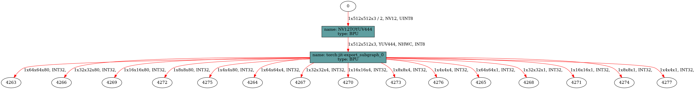
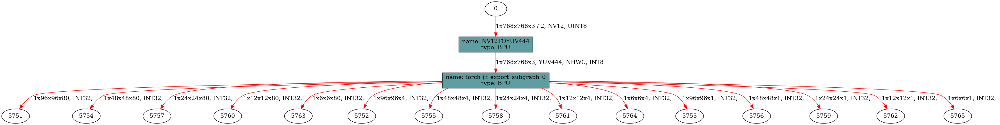
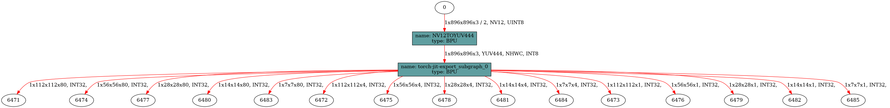

[English](README.md) | 简体中文

# FCOS 转换

<a id="source-model"></a>

## 源模型

- 框架：固定 X5 参考记录了 FCOS EfficientNet-B0/B2/B3 部署制品，但没有训练权重文件或导出脚本。
- 权重：`platforms/x5` 固定快照 `ac115717197920355fc390bb04299b20e6436864`。
- 对应关系：三个发布制品分别为 512、768、896 FCOS 变体；源 README 和截图没有给出权重文件发布版或训练 commit。

<a id="directory"></a>
## 目录结构

```text
conversion/
├── README.md  # 英文说明
└── README_cn.md  # 中文说明
```

<a id="toolchain-targets"></a>
## 工具链与目标

| 目标板卡 | march | OE 版本 | 配置 |
| --- | --- | --- | --- |
| x5 / B0 512 | bayes-e | 源未记录 | 源无 YAML |
| x5 / B2 768 | bayes-e | 源未记录 | 源无 YAML |
| x5 / B3 896 | bayes-e | 源未记录 | 源无 YAML |

下面三张 `hb_perf` 图展示各发布变体的部署数据流。每张图记录一个已发布变体的部署数据流：packed NV12 输入先经 BPU `NV12TOYUV444` 节点转成 `YUV444, NHWC, INT8`，再以 `torch-jit-export_subgraph_0` 在 BPU 上执行，输出 15 个 INT32 张量——5 个 stride 层级 × 3 个分支（80 通道分类分数、4 通道框回归、1 通道 center-ness）。这就是源输出协议：5 路分类、5 路框回归、5 路 center-ness 输出；Python 运行时会先按固定张量形状重排这些输出，再执行解码，解码语义见 [runtime 说明](../runtime/python/README_cn.md)。

参考图（逐字源快照，非本 checkout 产物）：



FCOS EfficientNet-B0，512×512 输入：64×64、32×32、16×16、8×8、4×4 五个层级（stride 8–128）上的分数/框/center-ness 头。



FCOS EfficientNet-B2，768×768 输入：同样三个分支位于 96×96 至 6×6 层级。



FCOS EfficientNet-B3，896×896 输入：同样三个分支位于 112×112 至 7×7 层级。

<a id="export"></a>
## ONNX 导出

准备所选 B0/B2/B3 变体的训练权重与导出脚本，固定输入预处理及十五个输出头的名称、形状和类型。本目录未提供权重或导出脚本。

<a id="calibration"></a>
## 校准

- 数据集：源未记录；没有校准文件或样本数量。
- 配置：没有 FCOS YAML。
- 命令：没有可复现校准命令。

<a id="compile"></a>
## 编译

在匹配的 X5 OpenExplorer 环境中准备 ONNX 和量化 YAML，再运行 `hb_mapper makertbin --model-type onnx --config your_fcos_config.yaml`。将 `your_fcos_config.yaml` 替换为实际配置路径；本目录未提供该文件。

<a id="validation"></a>
## 转换后验证

在匹配 X5 上，对提供的制品运行 `hrt_model_exec model_info --model_file <exact-file>`，再按运行时 README 执行。将命令输出、15 个 raw 张量元数据和结果 JSON 保存到同一 UTC 证据目录。[评估器](../evaluator/README_cn.md#reference-results)另提供已发布制品的已记录板端对拍运行。

<a id="artifacts"></a>
## 产物

| 制品 | 目标板卡 | 落盘 |
| --- | --- | --- |
| `fcos_efficientnetb0_detect_512x512_bayese_nv12.bin` | x5 | `model/` |
| `fcos_efficientnetb2_detect_768x768_bayese_nv12.bin` | x5 | `model/` |
| `fcos_efficientnetb3_detect_896x896_bayese_nv12.bin` | x5 | `model/` |

<a id="known-gaps"></a>
## 补充准备

自行转换需另行准备 FCOS EfficientNet-B0/B2/B3 权重、ONNX 导出脚本、代表性校准图片、X5 量化 YAML 和匹配的 OpenExplorer 工具链。本目录没有完整重建流程。运行示例可直接下载已发布 BIN；发布清单未提供 SHA-256。
