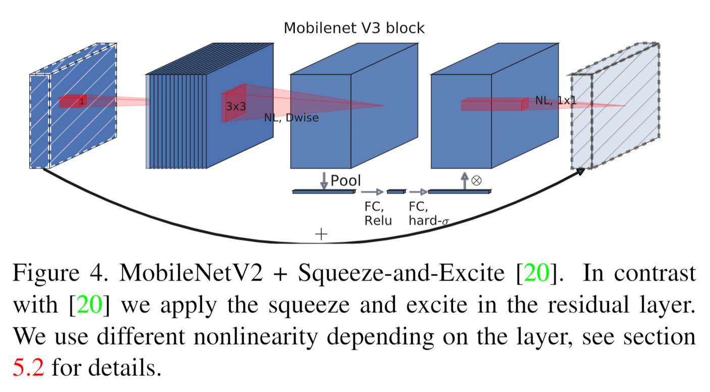
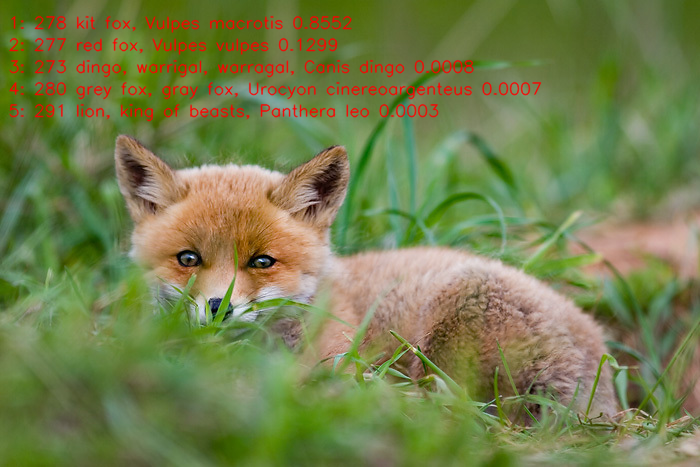

[English](README.md) | 简体中文

# MobileNetV3 图像分类

MobileNetV3 将倒残差模块与通道注意力结合，用于移动端图像分类。

来源：[timm/models/mobilenetv3.py](https://github.com/huggingface/pytorch-image-models/blob/main/timm/models/mobilenetv3.py) · [Searching for MobileNetV3](https://arxiv.org/abs/1905.02244)

<a id="overview"></a>

## 概述

在 `runtime/python` 运行 `python3 main.py`，分类实现在 `classify.py`。
支持的板卡和制品见下方支持表。参数与模型选择见 [runtime/python/README_cn.md](runtime/python/README_cn.md)。

### 算法背景

MobileNetV3 是 MobileNet 家族中经神经架构搜索得到的成员：NAS 加 NetAdapt
共同确定块配置，squeeze-and-excitation 注意力在倒残差块内重新标定通道
权重，h-swish 激活在移动硬件上保持低开销
（[论文](https://arxiv.org/abs/1905.02244)、
[timm/models/mobilenetv3.py](https://github.com/huggingface/pytorch-image-models/blob/main/timm/models/mobilenetv3.py)）。

特性摘要：

- **深度可分离卷积**：保留 MobileNet 系列的高效卷积结构。
- **倒残差结构**：使用 expansion–depthwise–projection 结构进行高效特征提取。
- **SE 注意力模块**：重新标定通道权重，提高特征表达能力。
- **H-Swish 激活函数**：硬件友好的激活函数，适合嵌入式部署。
- **模型变体**：本 sample 提供 MobileNetV3-Large-100、MobileNetV3-Small-100 两个部署模型（timm 检查点；INT16 激活、INT8 权重，仅 S100/S100P/S600）。



*MobileNetV3 块：在残差路径上施加
squeeze-and-excite 的倒残差块 — 在 NL depthwise 3×3 之后，全局池化加
FC-ReLU / FC-hard-sigmoid 门控作用于扩展通道，门控结果再经最后的 NL 1×1
投影输出（非线性按层选择）。*

<a id="directory"></a>
## 目录结构

```text
mobilenetv3/
├── conversion/  # 导出与量化配置
├── evaluator/  # 评估程序与指标
├── model/  # 模型文件与下载脚本
├── runtime/  # 推理程序
├── test_data/  # 示例输入
├── tests/  # 自动化测试
├── README.md  # 英文说明
├── README_cn.md  # 中文说明
└── requirements-host.txt  # Python 依赖
```

<a id="support-matrix"></a>
## 支持范围

下表列出本 Sample 已发布的模型；`—` 表示该组合未发布。

| 模型 | 输入 | X5 | S100 | S100P | S600 |
| --- | --- | --- | --- | --- | --- |
| MobileNetV3-Large | 224x224 | — | ✓ | ✓ | ✓ |
| MobileNetV3-Small | 224x224 | — | ✓ | ✓ | ✓ |

运行时覆盖：Python CLI 通过 `--target auto|s100|s100p|s600` 和
`--variant large|small`（默认 `large`）覆盖上表全部已发布组合。S 系列在
`s100/`、`s100p/`、`s600/` 目录下发布
`mobilenetv3_<block>_100_nashe/nashm/nashp_224x224_nv12.hbm`。清单未发布 X5
制品，`--target x5` 不会解析出任何资产。本 Sample 不提供 C++ 运行时。

<a id="prerequisites"></a>
## 环境前提

板端 Python 运行需要镜像中与板卡匹配的 `hbm_runtime`、NumPy、OpenCV-Python
和 Pillow（已发布模型要求抗锯齿双三次的短边缩放，由 Pillow 完成）；
只有真正执行模型时才导入 SDK（`--help`、`--list-models`、
`--dry-run` 与主机测试均不需要 SDK）。读取 Manifest 还需要 PyYAML。开发主机
可从 `requirements-host.txt` 安装用户态依赖：

```bash
# cwd：仓库根目录 — 成功判据：输出 "host dependencies: ok"
python3 -m venv .venv-mobilenetv3
source .venv-mobilenetv3/bin/activate
python3 -m pip install -r samples/vision/mobilenetv3/requirements-host.txt
python3 -c "import cv2, numpy, yaml, PIL; print('host dependencies: ok')"
```

<a id="quickstart"></a>
## 快速体验

在 S100 板卡上的一条完整路径（命令在仓库根目录执行）。前置条件：带
`hbm_runtime` 的板卡镜像与可访问 Manifest 模型服务器的网络。

```bash
# 1. 准备制品（输入：Manifest 行 s:mobilenetv3:s100/mobilenetv3_large_100_nashe_224x224_nv12.hbm）
#    输出：samples/vision/mobilenetv3/model/s100/mobilenetv3_large_100_nashe_224x224_nv12.hbm
#    成功判据：退出码 0 并打印观察 digest
bash samples/vision/mobilenetv3/model/download.sh s100 large

# 2. 运行分类（输入：上一步制品与内置测试图）
#    输出：stdout 上的 Top-5 类别 ID、分数、标签
#    成功判据：退出码 0 且打印 Top-5 列表
python3 samples/vision/mobilenetv3/runtime/python/main.py \
  --target s100 \
  --asset-id s:mobilenetv3:s100/mobilenetv3_large_100_nashe_224x224_nv12.hbm \
  --model-path samples/vision/mobilenetv3/model/s100/mobilenetv3_large_100_nashe_224x224_nv12.hbm \
  --test-img samples/vision/mobilenetv3/test_data/kit_fox.JPEG \
  --label-file datasets/imagenet/imagenet_classes.names
```

S100P、S600 换用对应的 `s:` 引用（见 `--list-models`）与根目录
`datasets/imagenet/` 标签。完整命令见
[runtime/python/README_cn.md](runtime/python/README_cn.md)。

<a id="expected-results"></a>
## 预期结果

Python 运行打印稳定的 Top-K（默认 5）类别 ID、分数与标签并退出 0；除非给出
`--img-save-path`，否则不写任何输出文件。使用内置测试图 `kit_fox.JPEG` 时，Top-1 为
class 278（`kit fox`）；使用 `zebra_cls.jpg` 时 Top-1 为 class 340（`zebra`），S100、S100P、S600 上的
两个变体都是如此。按支持矩阵选择目标并准备对应制品；运行时会在加载模型前核验板卡身份。

<a id="performance"></a>
## 性能数据

下列数字均在真实板卡上用已发布制品测得（INT16 激活、INT8 权重，224x224，batch 1）。模型规模为
5.48 M 参数 / 0.43 GFLOPs（Large-100）、2.54 M 参数 / 0.11 GFLOPs（Small-100）；
GFLOPs 按每次 Conv 与 Gemm 乘加计 2 次运算。

**精度。** 在完整的 ImageNetV2 MatchedFrequency 集合（10,000 张图像，1,000
类）上的 Top-1 / Top-5。它不是 ILSVRC2012 验证集，因此数值不能与 ImageNet-1k
验证集的结果相比。“FP32”是同一检查点的 ONNX 导出在相同裁剪图上的结果；
“板端”是编译后的模型在对应板卡上的结果。

| 模型 | Target | FP32 Top-1 | 板端 Top-1 | FP32 Top-5 | 板端 Top-5 |
| --- | --- | --- | --- | --- | --- |
| MobileNetV3-Large-100 | S100 | 63.20% | 62.99% | 83.76% | 83.75% |
| MobileNetV3-Large-100 | S100P | 63.20% | 62.99% | 83.76% | 83.75% |
| MobileNetV3-Large-100 | S600 | 63.20% | 63.00% | 83.76% | 83.74% |
| MobileNetV3-Small-100 | S100 | 54.47% | 53.29% | 77.49% | 76.50% |
| MobileNetV3-Small-100 | S100P | 54.47% | 53.29% | 77.49% | 76.50% |
| MobileNetV3-Small-100 | S600 | 54.47% | 53.44% | 77.49% | 76.65% |

MobileNetV3 只发布 S100、S100P、S600 三个平台，激活为 INT16、权重为 INT8。
它的 hard-swish 与 SE 激活在不同通道间相差可达约 100 倍，INT8 激活会损失
18%（Large）到几乎全部（Small）的 FP32 Top-1。X5 工具链无法以 INT16 运行
MobileNetV3 的 stride 2 depthwise 卷积与 SE 池化，所有尝试过的 X5 配置都无法把
损失控制在 5% 以内，因此没有 X5 构建。与同一模型的 INT8 构建相比，INT16 使模型
runtime 慢 1.5-2.1 倍。

**速度。** Runtime 数字来自 BPU 核 0 上的 `hrt_model_exec perf`（只含模型：
不含前处理与后处理）；FPS 为 3 次运行（每次 200 帧、先热身 20 帧）完成的
总帧数除以共同墙钟时间。C++ 流水线一列统计从内存中的 BGR 图像到 Top-5 列表的
单帧耗时，包括缩放、裁剪、NV12 打包、输入上传、推理和排序（不含读文件与
解码），分别为 1 路与 2 路独立流。

| 模型 | Target | Runtime 延迟，1 线程（ms） | Runtime FPS，1 / 2 线程 | C++ 流水线 FPS，1 / 2 路 | CPU / BPU（GHz） | CPU 线程数 |
| --- | --- | --- | --- | --- | --- | --- |
| MobileNetV3-Large-100 | S100 | 1.065 | 923 / 1,243 | 302 / 383 | 1.5 / 1.0 | 6 |
| MobileNetV3-Large-100 | S100P | 0.853 | 1,148 / 1,601 | 389 / 496 | 2.0 / 1.5 | 6 |
| MobileNetV3-Large-100 | S600 | 0.709 | 1,383 / 2,688 | 567 / 1,016 | 2.1 / 1.5 | 18 |
| MobileNetV3-Small-100 | S100 | 0.670 | 1,458 / 2,428 | 320 / 379 | 1.5 / 1.0 | 6 |
| MobileNetV3-Small-100 | S100P | 0.560 | 1,731 / 2,989 | 433 / 529 | 2.0 / 1.5 | 6 |
| MobileNetV3-Small-100 | S600 | 0.497 | 1,959 / 3,806 | 650 / 1,071 | 2.1 / 1.5 | 18 |

每次测量时 CPU 调频策略为 `performance`，所有在线核心运行在表中所列频率；
各板卡的 CPU 与 BPU 频率不同，比较不同 target 时需谨慎。C++ 流水线使用对
Pillow 双三次缩放的标量、逐位一致的重新实现，它主导了前处理耗时；表中延迟列为该实现的实测值。复现精度数字见[评测器](evaluator/README_cn.md)；C++ 计时工具
见[基准说明](../../../utils/tools/classification/cpp/README.md)。



*MobileNetV3-large 模型在 RDK S100 上的参考推理结果，由 `--img-save-path` 写出：随仓
[kit_fox.JPEG](test_data/kit_fox.JPEG) 的 Rank-1 为 `kit fox`（分数 0.855），其后依次为 red fox、dingo、grey fox、lion。*

<a id="entry-points"></a>
## 入口

- 模型准备：[model/README_cn.md](model/README_cn.md)
- Python 运行：[runtime/python/README_cn.md](runtime/python/README_cn.md)
- 转换：[conversion/README_cn.md](conversion/README_cn.md)
- 评估：[evaluator/README_cn.md](evaluator/README_cn.md)

<a id="license"></a>
## 许可

样例代码遵循仓库顶层 LICENSE（Apache-2.0）。源模型为 MobileNetV3 上游发布；
模型/权重许可以上游分发为准（见上方参考实现链接）。发布制品遵循平台发布
Manifest 中的模型文件按各自上游许可使用；再分发前请核对其适用条款。
