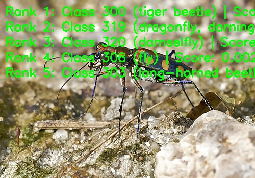

English | [简体中文](README_cn.md)

# MobileOne image classification

MobileOne folds training branches into a simple convolutional network for inference.

[中文说明](README_cn.md)

<a id="overview"></a>

## Overview

MobileOne is a lightweight CNN backbone designed for low-latency deployment on edge devices. The model uses structural re-parameterization to keep training-time expressiveness while simplifying the inference-time structure.

- **Paper**: [MobileOne: An Improved One millisecond Mobile Backbone](http://arxiv.org/abs/2206.04040)
- **Reference Implementation**: [apple/ml-mobileone](https://github.com/apple/ml-mobileone)

Feature highlights:

- **Structural re-parameterization** — fuses multi-branch training blocks
  (k parallel conv branches plus branch-wise BN and an identity branch,
  with ReLU or SE-ReLU) into a single inference-friendly conv per block.
- **Low-latency backbone** — targets mobile and embedded deployment with
  strong throughput.
- **Variant scaling** — published variants from `S0` to `S4`, with the
  over-parameterization factor `k` tuned per variant.
- **Classification output** — Top-K class IDs and confidence scores for
  ImageNet-1k labels.


*Figure (upstream paper Fig. 3): the MobileOne block has two structures —
train time with reparameterizable branches (left), inference time with
the branches folded into a single 3×3 / 1×1 convolution (right). The
train/inference split explains why the deployed artifacts are the
already-reparameterized INT8 s0–s4 variants at 224×224 NV12 (see [Support
matrix](#support-matrix)).*

One BGR image produces ImageNet-1k Top-K class IDs, scores and optional
labels. The `MobileOneClassifier` class runs a `preprocess → infer → postprocess` flow
chained by `predict` (labels, drawing and file output belong to the CLI
layer; see [runtime/python/README.md](runtime/python/README.md)).

<a id="directory"></a>
## Directory structure

```text
mobileone/
├── conversion/  # Export and quantization configuration
├── evaluator/  # Evaluation commands and metrics
├── model/  # Model files and download scripts
├── runtime/  # Python inference
├── test_data/  # Example inputs
├── tests/  # Automated tests
├── README.md  # English instructions
├── README_cn.md  # Chinese instructions
└── requirements-host.txt  # Python dependencies
```

<a id="support-matrix"></a>
## Support matrix

The table lists the models published for this sample; `—` marks an
unpublished combination.

| Model | Input | X5 | S100 | S100P | S600 |
| --- | --- | --- | --- | --- | --- |
| MobileOne-S0 | 224x224 | ✓ | — | — | — |
| MobileOne-S1 | 224x224 | ✓ | — | — | — |
| MobileOne-S2 | 224x224 | ✓ | — | — | — |
| MobileOne-S3 | 224x224 | ✓ | — | — | — |
| MobileOne-S4 | 224x224 | ✓ | — | — | — |

Runtime coverage: the Python CLI serves every published combination with
`--target auto|x5` and `--variant s0|s1|s2|s3|s4` (default `s0`); the
lowercase CLI ID resolves to the exact case-sensitive published filename
`MobileOne_S<0-4>_224x224_nv12.bin`. `--target s100`, `s100p` and `s600`
resolve no asset. The sample ships no C++ runtime.

<a id="prerequisites"></a>
## Prerequisites

Use a full repository checkout. On X5 use the matching board image and its `hbm_runtime`; install host dependencies in a virtual environment as below. Host-side comparison tools use SciPy; board inference uses the dependencies in the matching runtime image.

Use a full repository checkout. On X5 use the matching board image and
its `hbm_runtime`; install the host dependencies in a virtual environment
as below. Host-side comparison tools use SciPy; board inference uses the dependencies in the matching runtime image. Native inference needs no OE toolchain; conversion
prerequisites are documented under [conversion](conversion/README.md).
```bash
# cwd: repository root
python3 -m venv .venv-mobileone
source .venv-mobileone/bin/activate
python3 -m pip install -r samples/vision/mobileone/requirements-host.txt
python3 -c "import cv2, numpy, yaml; print('host dependencies: ok')"
```

<a id="quickstart"></a>
## Quick start

From the repository root, prepare the X5 artifact with the model downloader, then run inference with the bundled image and the selected artifact reference.

```bash
# cwd: repository root
bash samples/vision/mobileone/model/download.sh x5 s0
python3 samples/vision/mobileone/runtime/python/main.py \
  --target x5 --variant s0 \
  --test-img samples/vision/mobileone/test_data/tiger_beetle.JPEG \
  --label-file datasets/imagenet/imagenet_classes.names
```

<a id="expected-results"></a>
## Expected results

The default variant is `s0`; the other variants are chosen explicitly. Softmax scores produce a stable Top-K, with exact ties ordered by ascending class ID. `tiger_beetle.JPEG` is the bundled functional input; use the evaluator guide for dataset accuracy. Pass `--img-save-path` to save an image; otherwise results are printed to stdout.

The screenshot below shows a reference run from the X5 release: the
demo overlay draws the top-5 ranks onto the bundled test image, with
rank 1 being class 300 (tiger beetle).



<a id="performance"></a>
## Performance data

Published performance records; full timing conditions and all columns
are listed under [evaluation](evaluator/README.md#reference-results).
Single-thread latency and multi-thread FPS are measured under different
concurrency and are not reciprocal quantities. Compare latency and FPS using
the same thread count, concurrent submission mode and BPU utilization.

<a id="entry-points"></a>
## Entry points

[Model](model/README.md) · [Python](runtime/python/README.md) · [Conversion](conversion/README.md) · [Evaluation](evaluator/README.md)

<a id="license"></a>
## License

Source Python headers retain Apache-2.0 provenance. Conversion YAMLs retain their original proprietary notices verbatim; before redistribution, follow the original conversion YAML notices and applicable upstream weight license terms.

<!-- converted-batch-20261102 -->
## Converted-only additions (2026-11-02)

These independently converted timm weights have passed strict checkpoint loading,
reparameterization and two-input PyTorch/ONNX host comparison, checker and compiler.
Board smoke, accuracy, Runtime 1/2 and C++ 1/2 are **not-run**; historical metrics
and screenshots do not describe these artifacts. Existing defaults are retained.
Pillow is needed for the explicit bicubic shorter-edge 256 / rounded center crop
224 profile. Normalization is fused in Mapper from the actual checkpoint config;
output is float32 1,000-class logits followed by native softmax.

| Variant | Artifact | Checkpoint revision | Board |
|---|---|---|---|
| `timm-s0-apple-in1k` | `mobileone_s0_apple_in1k_bayese_224x224_nv12.bin` | [`2f1da1a4433b`](https://huggingface.co/timm/mobileone_s0.apple_in1k/blob/2f1da1a4433b0636bace873cab611c9ee90d40de/README.md) | not-run |
| `timm-s1-apple-in1k` | `mobileone_s1_apple_in1k_bayese_224x224_nv12.bin` | [`c4a13fe645a4`](https://huggingface.co/timm/mobileone_s1.apple_in1k/blob/c4a13fe645a42cbb683439dfb1934c815155f2a0/README.md) | not-run |
| `timm-s2-apple-in1k` | `mobileone_s2_apple_in1k_bayese_224x224_nv12.bin` | [`0cd6548c3117`](https://huggingface.co/timm/mobileone_s2.apple_in1k/blob/0cd6548c311753d2dd525d414c22fce35738264c/README.md) | not-run |
| `timm-s3-apple-in1k` | `mobileone_s3_apple_in1k_bayese_224x224_nv12.bin` | [`29a687f5d735`](https://huggingface.co/timm/mobileone_s3.apple_in1k/blob/29a687f5d735adb9ee23667dce14b60e8eaa6e88/README.md) | not-run |
| `timm-s4-apple-in1k` | `mobileone_s4_apple_in1k_bayese_224x224_nv12.bin` | [`f4dfe4c260ea`](https://huggingface.co/timm/mobileone_s4.apple_in1k/blob/f4dfe4c260ea8d7d07ac6c06042fe254efdd329a/README.md) | not-run |

```bash
python3 samples/vision/mobileone/model/download.py --target x5 --variant timm-s0-apple-in1k
python3 samples/vision/mobileone/runtime/python/main.py --target x5 --variant timm-s0-apple-in1k --dry-run
```

Exact model URLs/SHA-256/size are in `docs/release/x5/models.yaml`; source and host
receipts are in `conversion/converted.json`. Each weight retains its own model
license in its public release manifest. No board result is implied by download.
<!-- /converted-batch-20261102 -->

<!-- converted-all-20261103 -->

## Converted S profiles (2026-11-03)

Independent converted profiles and explicit commands are listed in [model preparation](model/README.md). Board accuracy and performance are not measured yet.
