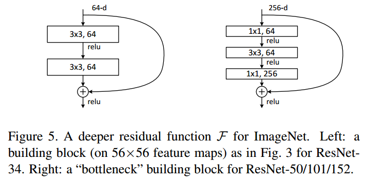
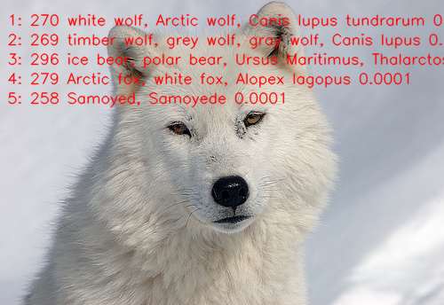

English | [简体中文](README_cn.md)

# ResNet image classification

ResNet uses residual connections to train deep image classifiers.

Sources: [timm/models/resnet](https://github.com/huggingface/pytorch-image-models/blob/main/timm/models/resnet.py) · [Deep Residual Learning for Image Recognition](https://arxiv.org/abs/1512.03385) · [ResNet strikes back](https://arxiv.org/abs/2110.00476)

<a id="overview"></a>

## Overview

Python covers every board in the support table. C++ covers S100, S100P, and S600.
From `runtime/python`, run `python3 main.py`; the classifier is `classify.py`.
Options and model selection: [runtime/python/README.md](runtime/python/README.md).
C++ build and run: [runtime/cpp/README.md](runtime/cpp/README.md).

### Algorithm background

ResNet was proposed by Kaiming He, Xiangyu Zhang, Shaoqing Ren, and Jian
Sun. Residual learning with shortcut connections lets each block learn a
residual instead of the full mapping, which stabilizes deep-network
optimization and avoids the degradation that plain layer stacks suffer as
depth grows ([paper](https://arxiv.org/abs/1512.03385),
[timm/models/resnet](https://github.com/huggingface/pytorch-image-models/blob/main/timm/models/resnet.py)).
The published models keep the original architecture and use the timm
`a1_in1k` weights, trained with the A1 recipe of "ResNet strikes back"
([paper](https://arxiv.org/abs/2110.00476)).

Feature summary:

- **Residual learning**: identity shortcuts add each block's input to its output, so added depth does not degrade optimization.
- **Basic and bottleneck blocks**: ResNet-18/34 stack two 3×3 convolutions per block; ResNet-50/101/152 use `1x1 → 3x3 → 1x1` bottleneck blocks.
- **Classification output**: Top-K class IDs and confidence scores for ImageNet-1k labels.
- **Model variants**: this sample ships the ResNet-18, ResNet-34, ResNet-50, ResNet-101 and ResNet-152 deployment models (timm checkpoints, INT8).



*The residual building block of ResNet-18/34 (left, two 3×3
convolutions) and the bottleneck building block of ResNet-50/101/152
(right, 1×1 → 3×3 → 1×1), Figure 5 of the ResNet paper.*

<a id="directory"></a>
## Directory structure

```text
resnet/
├── conversion/  # Export and quantization configuration
├── evaluator/  # Evaluation commands and metrics
├── model/  # Model files and download scripts
├── runtime/  # Python and native inference implementations
├── test_data/  # Example inputs
├── tests/  # Automated tests
├── README.md  # English instructions
├── README_cn.md  # Chinese instructions
└── requirements-host.txt  # Python dependencies
```

<a id="support-matrix"></a>
## Support matrix

The table lists the models published for this sample; `—` marks an
unpublished combination. All published artifacts are INT8 ImageNet-1k
classifiers at 224x224.

| Model | Input | X5 | S100 | S100P | S600 |
| --- | --- | --- | --- | --- | --- |
| ResNet-18 | 224x224 | ✓ | ✓ | ✓ | ✓ |
| ResNet-34 | 224x224 | ✓ | ✓ | ✓ | ✓ |
| ResNet-50 | 224x224 | ✓ | ✓ | ✓ | ✓ |
| ResNet-101 | 224x224 | ✓ | ✓ | ✓ | ✓ |
| ResNet-152 | 224x224 | ✓ | ✓ | ✓ | ✓ |

Runtime coverage:

- Python serves every combination in the table. `--target auto|x5|s100|s100p|s600`
  resolves the matching manifest artifact (`--list-models` prints the exact
  references): X5 publishes `resnet<size>_bayese_224x224_nv12.bin`; the S
  series publishes `resnet<size>_nashe/nashm/nashp_224x224_nv12.hbm` under
  `s100/`, `s100p/` and `s600/`. The default variant is ResNet-18.
- C++ ([runtime/cpp](runtime/cpp/README.md)) serves the same five variants on
  S100, S100P and S600 only (`VARIANT=18|34|50|101|152`, default 18); X5 has
  no C++ runtime.

<a id="prerequisites"></a>
## Prerequisites

Board Python execution needs the board image's matching `hbm_runtime`,
NumPy, OpenCV-Python, and Pillow (the published models expect an antialiased
bicubic shorter-edge resize, which Pillow performs); the SDK is imported only
when a model executes
(`--help`, `--list-models`, `--dry-run` need no SDK).
Manifest reading also needs PyYAML. On a development host, install the
user-space dependencies from `requirements-host.txt`:

```bash
# cwd: repository root — output: "host dependencies: ok"
python3 -m venv .venv-resnet
source .venv-resnet/bin/activate
python3 -m pip install -r samples/vision/resnet/requirements-host.txt
python3 -c "import cv2, numpy, yaml, PIL; print('host dependencies: ok')"
```

The C++ build needs CMake, a C++17 compiler, OpenCV and gflags
development packages, and the Horizon DNN headers/libraries — see
[runtime/cpp/README.md](runtime/cpp/README.md).

<a id="quickstart"></a>
## Quick start

One complete path on an X5 board, commands run from the repository root.
Prerequisite: the board image with `hbm_runtime` and network access to the
manifest's model server.

```bash
# 1. Prepare the artifact (input: manifest row x5:resnet:resnet18_bayese_224x224_nv12.bin)
#    output: samples/vision/resnet/model/resnet18_bayese_224x224_nv12.bin
#    output: downloader exits 0 and prints the observed digest
bash samples/vision/resnet/model/download.sh x5 18

# 2. Run classification (input: the artifact above plus the bundled test image)
#    output: Top-5 class ids, scores, labels on stdout
#    output: exit code 0 and a printed Top-5 list
python3 samples/vision/resnet/runtime/python/main.py \
  --target x5 \
  --asset-id x5:resnet:resnet18_bayese_224x224_nv12.bin \
  --model-path samples/vision/resnet/model/resnet18_bayese_224x224_nv12.bin \
  --test-img samples/vision/resnet/test_data/white_wolf.JPEG \
  --label-file datasets/imagenet/imagenet_classes.names
```

For S100, S100P and S600 use the matching `s:` reference (see `--list-models`) and the
same root `datasets/imagenet/` labels. Full commands:
[runtime/python/README.md](runtime/python/README.md).
For the C++ flow (S100, S100P, S600) use `bash samples/vision/resnet/runtime/cpp/run.sh`.

<a id="expected-results"></a>
## Expected results

The Python run prints a stable Top-K (default 5) of class IDs, scores, and
labels and exits 0. Pass `--img-save-path` to save a visualization; otherwise results are printed to stdout. With the bundled `white_wolf.JPEG` the Top-1 is class 270 (`white wolf`)
and with `zebra_cls.jpg` it is class 340 (`zebra`), for every variant on X5, S100, S100P
and S600 (checked on each board with the published builds). Select a target and variant listed in the [Support matrix](#support-matrix), prepare that exact manifest artifact with the model downloader, and run the sample on the matching board.

<a id="performance"></a>
## Performance data

All numbers were measured on real boards with the published artifacts
(INT8, 224x224, batch 1). The models are 11.69 M parameters / 3.63 GFLOPs (18), 21.80 M parameters / 7.33 GFLOPs (34), 25.56 M parameters / 8.18 GFLOPs (50), 44.55 M parameters / 15.60 GFLOPs (101) and 60.19 M parameters / 23.03 GFLOPs (152);
GFLOPs counts Conv and Gemm multiply-accumulates as two operations.

**Accuracy.** Top-1 / Top-5 over the complete ImageNetV2 MatchedFrequency set
(10,000 images, 1,000 classes). This is not the ILSVRC2012 validation set, so
the values are not comparable with ImageNet-1k validation figures. "FP32" is
the ONNX export of the same checkpoint evaluated on the same crops; "Board" is
the compiled model on the matching board.

| Model | Target | FP32 Top-1 | Board Top-1 | FP32 Top-5 | Board Top-5 |
| --- | --- | --- | --- | --- | --- |
| ResNet-18 | X5 | 59.35% | 58.91% | 80.94% | 80.56% |
| ResNet-18 | S100 | 59.35% | 58.79% | 80.94% | 80.46% |
| ResNet-18 | S100P | 59.35% | 58.79% | 80.94% | 80.46% |
| ResNet-18 | S600 | 59.35% | 58.88% | 80.94% | 80.58% |
| ResNet-34 | X5 | 64.92% | 64.30% | 85.06% | 84.71% |
| ResNet-34 | S100 | 64.92% | 64.26% | 85.06% | 84.75% |
| ResNet-34 | S100P | 64.92% | 64.26% | 85.06% | 84.75% |
| ResNet-34 | S600 | 64.92% | 64.23% | 85.06% | 84.75% |
| ResNet-50 | X5 | 68.84% | 66.90% | 87.59% | 86.25% |
| ResNet-50 | S100 | 68.84% | 67.01% | 87.59% | 86.40% |
| ResNet-50 | S100P | 68.84% | 67.01% | 87.59% | 86.40% |
| ResNet-50 | S600 | 68.84% | 66.94% | 87.59% | 86.41% |
| ResNet-101 | X5 | 70.32% | 68.59% | 88.35% | 87.66% |
| ResNet-101 | S100 | 70.32% | 68.64% | 88.35% | 87.67% |
| ResNet-101 | S100P | 70.32% | 68.64% | 88.35% | 87.67% |
| ResNet-101 | S600 | 70.32% | 68.65% | 88.35% | 87.56% |
| ResNet-152 | X5 | 70.87% | 69.34% | 88.16% | 87.78% |
| ResNet-152 | S100 | 70.87% | 69.27% | 88.16% | 87.74% |
| ResNet-152 | S100P | 70.87% | 69.27% | 88.16% | 87.74% |
| ResNet-152 | S600 | 70.87% | 69.22% | 88.16% | 87.74% |

**Speed.** Runtime numbers come from `hrt_model_exec perf` on BPU core 0 (the
model only: no preprocessing or postprocessing); FPS is the total completed
frames divided by the common wall time of 3 runs x 200 frames after a 20-frame
warmup. The C++ pipeline column times one frame from an in-memory BGR image to
a Top-5 list, including resize, crop, NV12 packing, input upload, inference,
and ranking (file reading and decoding excluded), for 1 and 2 independent
streams.

| Model | Target | Runtime latency, 1 thread (ms) | Runtime FPS, 1 / 2 threads | C++ pipeline FPS, 1 / 2 streams | CPU / BPU (GHz) | CPU threads |
| --- | --- | --- | --- | --- | --- | --- |
| ResNet-18 | X5 | 2.740 | 364 / 409 | 95 / 109 | 1.5 / 1.0 | 8 |
| ResNet-18 | S100 | 0.631 | 1,553 / 2,583 | 363 / 440 | 1.5 / 1.0 | 6 |
| ResNet-18 | S100P | 0.534 | 1,826 / 3,048 | 456 / 565 | 2.0 / 1.5 | 6 |
| ResNet-18 | S600 | 0.394 | 2,452 / 4,738 | 715 / 930 | 2.1 / 1.5 | 18 |
| ResNet-34 | X5 | 4.625 | 216 / 231 | 80 / 96 | 1.5 / 1.0 | 8 |
| ResNet-34 | S100 | 0.918 | 1,066 / 1,513 | 329 / 409 | 1.5 / 1.0 | 6 |
| ResNet-34 | S100P | 0.791 | 1,237 / 1,747 | 409 / 525 | 2.0 / 1.5 | 6 |
| ResNet-34 | S600 | 0.525 | 1,860 / 3,493 | 650 / 1,003 | 2.1 / 1.5 | 18 |
| ResNet-50 | X5 | 5.404 | 185 / 196 | 76 / 92 | 1.5 / 1.0 | 8 |
| ResNet-50 | S100 | 1.070 | 919 / 1,231 | 311 / 396 | 1.5 / 1.0 | 6 |
| ResNet-50 | S100P | 0.916 | 1,072 / 1,433 | 392 / 510 | 2.0 / 1.5 | 6 |
| ResNet-50 | S600 | 0.593 | 1,652 / 3,081 | 628 / 1,050 | 2.1 / 1.5 | 18 |
| ResNet-101 | X5 | 9.044 | 110 / 115 | 59 / 113 | 1.5 / 1.0 | 8 |
| ResNet-101 | S100 | 1.614 | 613 / 739 | 266 / 380 | 1.5 / 1.0 | 6 |
| ResNet-101 | S100P | 1.395 | 709 / 852 | 329 / 524 | 2.0 / 1.5 | 6 |
| ResNet-101 | S600 | 0.876 | 1,123 / 2,077 | 528 / 941 | 2.1 / 1.5 | 18 |
| ResNet-152 | X5 | 12.332 | 81 / 83 | 49 / 83 | 1.5 / 1.0 | 8 |
| ResNet-152 | S100 | 2.128 | 466 / 536 | 235 / 423 | 1.5 / 1.0 | 6 |
| ResNet-152 | S100P | 1.842 | 538 / 618 | 285 / 545 | 2.0 / 1.5 | 6 |
| ResNet-152 | S600 | 1.137 | 869 / 1,598 | 467 / 831 | 2.1 / 1.5 | 18 |

The CPU governor was `performance` and the CPUs ran at the clock listed (all
online cores) during each measurement; the boards differ in CPU and BPU clocks,
so compare targets with care. The C++ pipeline uses a scalar, bit-exact
reimplementation of Pillow's bicubic resize, which dominates its preprocessing
time; the latency columns record this implementation's measured cost. To reproduce the accuracy numbers see the
[evaluator](evaluator/README.md); the C++ timing tool is described in the
[benchmark instructions](../../../utils/tools/classification/cpp/README.md).



*Reference inference result of the ResNet-18 model on an RDK X5, written with
`--img-save-path`: the bundled
[white_wolf.JPEG](test_data/white_wolf.JPEG) ranks `white wolf` first (score 0.998), followed by timber wolf, ice bear, Arctic fox, and Samoyed.*

<a id="entry-points"></a>
## Entry points

- Model preparation: [model/README.md](model/README.md)
- Python runtime: [runtime/python/README.md](runtime/python/README.md)
- Conversion: [conversion/README.md](conversion/README.md)
- Evaluation: [evaluator/README.md](evaluator/README.md)
- C++ runtime (S100/S100P/S600): [runtime/cpp/README.md](runtime/cpp/README.md)

<a id="license"></a>
## License

Sample code follows the repository top-level LICENSE (Apache-2.0). The
source model is the upstream ResNet distribution; upstream model/weights
licensing is governed by that distribution (see the reference-implementation
link above). Published artifacts follow the platform release manifests; the
manifests carry no separate license field, and no additional license is
claimed here.
