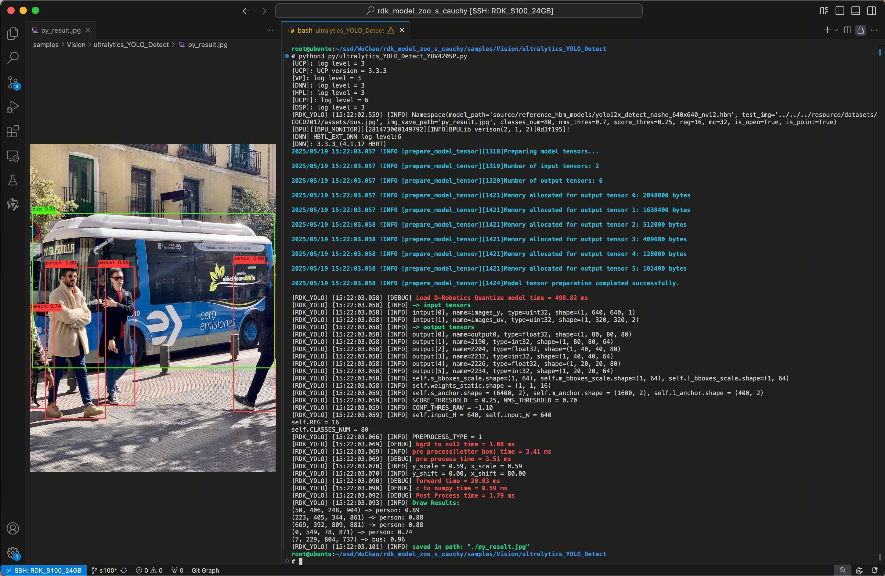
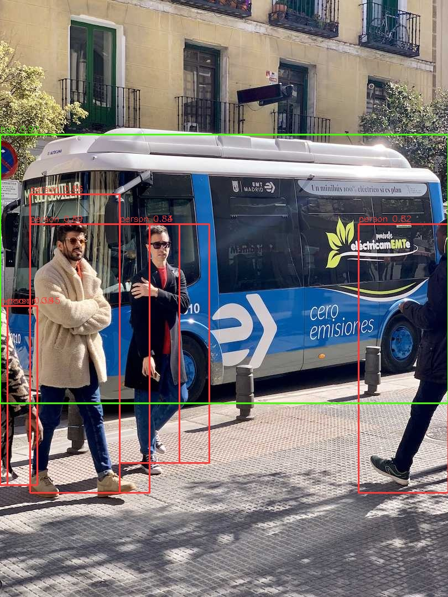
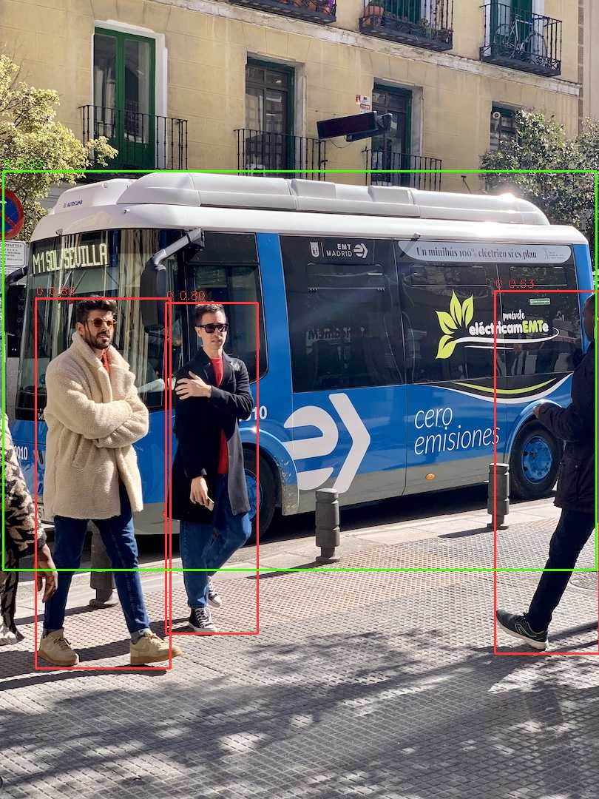

English | [简体中文](README_cn.md)

# Ultralytics YOLO

<a id="overview"></a>

## Overview

This sample provides object detection, instance segmentation, pose estimation, classification and YOLO26 oriented boxes for RDK X5, S100, S100P and S600. YOLO detection heads predict classes and boxes at multiple scales; CPU decoding/filtering restores original-image coordinates. Segmentation, pose and OBB also expose masks, keypoints and angles. Model source project: [Ultralytics](https://github.com/ultralytics/ultralytics).

Python binds inputs by target and selects task protocols by family, sharing preparation, rendering and evaluation. YOLOv5, YOLOE and yolo26_depth use separate sample interfaces.

<a id="directory"></a>
## Directory structure

```text
ultralytics_yolo/
├── conversion/  # Export and quantization configuration
├── evaluator/  # Evaluation commands and metrics
├── model/  # Model files and download scripts
├── runtime/  # Python and native inference implementations
├── test_data/  # Example inputs
├── README.md  # English instructions
└── README_cn.md  # Chinese instructions
```

<a id="support-matrix"></a>
## Support matrix

The table lists models published for this sample. Each cell shows the available model sizes; `—` indicates an unpublished combination. See the [evaluation guide](evaluator/README.md) for accuracy and performance.

| Model family | Task | X5 | S100 | S100P | S600 |
|---|---|---|---|---|---|
| YOLOv5u | detect | n/s/m/l/x | n/s/m/l/x | n/s/m/l/x | n/s/m/l/x |
| YOLOv8 / YOLO11 | detect / seg / pose / cls | n/s/m/l/x | n/s/m/l/x | n/s/m/l/x | n/s/m/l/x |
| YOLOv9 | detect | t/s/m/c/e | t/s/m/c/e | t/s/m/c/e | s/m/c/e |
| YOLOv9 | seg | c/e | c/e | c/e | — |
| YOLOv10 | detect | n/s/m/b/l/x | n/s/m/b/l/x | n/s/m/b/l/x | n/s/m/b/l/x |
| YOLO12 | detect | n/s/m/l/x | n/s/m/l/x | n/s/m/l/x | n/s/m/l/x |
| YOLOv13 | detect | n/s/l/x | — | — | — |
| YOLO26 | detect / seg / pose / cls / obb | n/s/m/l/x | n/s/m/l/x | n/s/m/l/x | n/s/m/l/x |

Select a published target/family/task/scale combination from the [model inventory](model/README.md).

How to run:

- Python provides entry points for every family/task combination in the table (see [Quick start](#quickstart)).
- C++ implements a subset; its scope and output requirements are documented in the [C++ guide](runtime/cpp/README.md). Known limitations: the published X5 segmentation, pose and OBB `.bin` artifacts fail the C++ runtime output binding and must run through the Python entry; S-series YOLOv10 is NMS-free while the C++ detect path always applies NMS, so S-series YOLOv10 also uses the Python entry (X5 YOLOv10 uses DFL+NMS).

| Runtime contract | X5 | S100 / S100P / S600 |
|---|---|---|
| Artifact | `.bin` / bayese | `.hbm` / nashe, nashm, nashp |
| NV12 input | One packed buffer | NHWC Y + UV |
| Python detection NMS default | 0.70 | 0.45; YOLOv10 is NMS-free |
| Classification CLI resize | YOLO26 stretch; others letterbox | Stretch |

<a id="prerequisites"></a>
## Prerequisites

Requires a complete checkout, Python 3, NumPy, OpenCV, SciPy and PyYAML; actual inference additionally needs `hbm_runtime` supplied by the matching board image. Use the board image and SDK paired with the selected artifact.

Runtime, download and host conversion environments are separate: C++ needs board development libraries, while ONNX/quantization compilation needs training and OE environments (see the subdirectories). Help/list/dry-run/download can run on a host. Hardware identity comes from the [shared platform registry](../../../docs/release/platforms.json).

<a id="quickstart"></a>
## Quick start

Run from the repository root. Prepare the model with network access, then run on a matching X5 board; the input image is bundled in test_data.

```bash
bash samples/vision/ultralytics_yolo/model/download_model.sh \
  --platform x5 --family yolov8 --task detect --model-size n
python samples/vision/ultralytics_yolo/runtime/python/main.py \
  --platform x5 --family yolov8 --task detect \
  --model-path samples/vision/ultralytics_yolo/model/yolov8n_detect_bayese_640x640_nv12.bin \
  --label-file datasets/coco/coco_classes.names \
  --test-img samples/vision/ultralytics_yolo/test_data/bus.jpg \
  --img-save-path /tmp/yolov8n-x5.jpg
```
For other targets use matching preparation arguments and paths from [model instructions](model/README.md). Explicit `--model-path` never downloads; when omitted, the entry downloads missing default assets. Specify `--family` for custom filenames. `--target` aliases `--platform`; actual inference rejects unknown boards and target mismatches.

Without a board, inspect selections without downloading or inference:

```bash
python samples/vision/ultralytics_yolo/runtime/python/main.py \
  --platform s100 --list-models
python samples/vision/ultralytics_yolo/runtime/python/main.py \
  --platform s600 --family yolo26 --task cls --dry-run
python samples/vision/ultralytics_yolo/runtime/python/main.py \
  --target x5 --task detect \
  --asset-id x5:ultralytics_yolo:yolov8n_detect_bayese_640x640_nv12.bin --dry-run
```

<a id="expected-results"></a>
## Expected results

The detection command prints model/input protocol and detections, writes the rendered image to `/tmp/yolov8n-x5.jpg`, and prints `[Saved]` on success. Boxes use original-image pixels and zero-based class IDs. Classification prints Top-K without an image; segmentation/pose/OBB fields are described in the [Python guide](runtime/python/README.md). Example detection visualization:



S-series detection visualization:



YOLO26 detection visualization with class IDs and scores:



<a id="entry-points"></a>
## Usage and source entry points

- [model](model/README.md) — Downloads, inventory, paths and digests.
- [runtime/python](runtime/python/README.md) — Task CLI, complete parameters, library integration and stage contracts.
- [runtime/cpp](runtime/cpp/README.md) — Task builds, positional arguments, lifecycle and measurement scope.
- [conversion](conversion/README.md) — Source weights, export, calibration and target compilation.
- [evaluator](evaluator/README.md) — COCO/ImageNet/DOTA task evaluation and reference measurements.
- [test_data](test_data/README.md) — Bundled input images, display-label tables and example visualizations.

In `runtime/python/`, `main.py` is the command-line entry, `cli.py` handles options, published-asset selection and result printing, `backend.py` loads the model and binds tensors, and the task files (`detect.py`/`segment.py`/`pose.py`/`obb.py`/`classify.py`) implement each task's preprocessing, inference and postprocessing. Detection DFL and YOLO26 direct LTRB are separate protocols; see the [detection input/output](runtime/python/README.md#detection-io). Input geometry comes from model metadata or an explicit fallback. YOLO26 OBB uses radians; X5 class-aware NMS/clipping differs from S-series targets.

<a id="license"></a>
## License and provenance

Sample code follows the repository [Apache-2.0 LICENSE](../../../LICENSE). Model weights and upstream training frameworks remain under their own licenses; check them separately. Artifact URLs and publisher SHA-256 values are listed in the manifests.

<a id="readable-example"></a>
<a id="custom-models"></a>
## Custom models

Compile your trained model with the [conversion flow](conversion/README.md),
then run it by path:

```bash
python samples/vision/ultralytics_yolo/runtime/python/main.py \
  --platform x5 --family yolov8 --task detect \
  --model-path /path/to/my_detect_model.bin \
  --classes-num 80 --label-file /path/to/my_classes.names \
  --test-img samples/vision/ultralytics_yolo/test_data/bus.jpg \
  --img-save-path /tmp/custom-detect.jpg
```

- An explicit `--model-path` is used as-is and never downloads; give a custom
  filename an explicit `--family` so the matching task protocol is selected.
- Without `--label-file`, results render class IDs. An explicit label file
  whose entry count differs from the model's class count fails before
  inference; custom detect/seg/obb graphs additionally need the matching
  `--classes-num`.
- The task classes (`YoloDetect`, `YoloSeg`, `YoloPose`, `YOLO26OBB` and
  `YoloCls` in `runtime/python/`) can be called from your own code:
  `predict` accepts an image path or a BGR array. The image-path convenience
  applies to detection; seg/pose/obb/cls take BGR arrays.
- Dataset scoring goes through the [evaluator](evaluator/README.md); further
  integration examples are collected in
  [docs/architecture/model-examples.md](../../../docs/architecture/model-examples.md).
