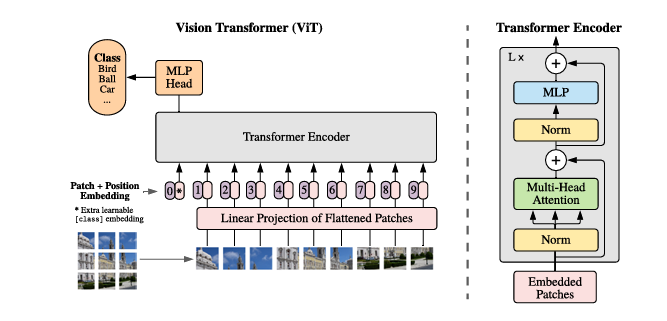

[English](README.md) | 简体中文

# ViT CIFAR-10 图像分类

ViT 将图像块组织为序列，通过自注意力完成分类。

<a id="overview"></a>
## 概述

ViT 把图像分块组织为序列，通过自注意力完成分类。本 sample 提供 S100 CIFAR-10 十分类的两个量化变体，不是 ImageNet 权重。

[Paper](https://arxiv.org/abs/2010.11929) · [Original ViT implementation](https://github.com/google-research/vision_transformer)



<a id="directory"></a>
## 目录结构

```text
vit/
├── conversion/  # 导出与量化配置
├── evaluator/  # 评估程序与指标
├── model/  # 模型文件与下载脚本
├── runtime/  # 推理程序
├── test_data/  # 示例输入
├── tests/  # 自动化测试
├── README.md  # 英文说明
├── README_cn.md  # 中文说明
└── requirements-host.txt  # Python 依赖
```

<a id="support-matrix"></a>
## 支持矩阵

下表列出本 Sample 已发布的模型；`—` 表示该组合未发布。两个已发布制品均为
CIFAR-10（10 类）ViT 分类模型，224x224、batch 1。

| 模型 | 输入 | X5 | S100 | S100P | S600 |
| --- | --- | --- | --- | --- | --- |
| ViT CIFAR-10 INT8 | 224x224 | — | ✓ | — | — |
| ViT CIFAR-10 INT16 | 224x224 | — | ✓ | — | — |

运行时覆盖：仅 S100 归档发布了这两个制品
（`s100/vit_cifar10_batch1_int8.hbm`、`s100/vit_cifar10_batch1_int16.hbm`）。
Python CLI 通过 `--target auto|s100` 和 `--variant int8|int16`（默认
`int8`）运行两者；`--target x5`、`s100p`、`s600` 不会解析出任何资产。本
Sample 不提供 C++ 运行时。

<a id="prerequisites"></a>
## 前提

需要完整仓库。S100 推理需要板端镜像提供的 `hbm_runtime`；主机侧依赖
按下方 `requirements-host.txt` 安装。磁盘需容纳仓库、所选 HBM 和输出。
只有重新转换需要 OE 工具链。

```bash
# cwd: repository root
python3 -m venv .venv-vit
source .venv-vit/bin/activate
python3 -m pip install -r samples/vision/vit/requirements-host.txt
```

<a id="quickstart"></a>
## 快速开始

在 S100 上先显式准备模型再运行；成功时退出 0，打印五个类别 ID/分数/标签。推理不会下载模型。

```bash
# cwd: repository root
bash samples/vision/vit/model/download.sh s100 int8
python3 samples/vision/vit/runtime/python/main.py --target s100 --variant int8 --test-img samples/vision/vit/test_data/airplane_0000.png --label-file samples/vision/vit/test_data/cifar10_classes.names --top-k 5
```

<a id="expected-results"></a>
## 预期结果

使用随附 `airplane_0000.png` 时，Top-5 包含 airplane。默认 int8、
resize=0、Top-K=5。分数是十个 logits 的 softmax；完全平局按 ID 升序。
仅 `--img-save-path` 写标注图片。

<a id="performance"></a>
## 性能数据

已发布的 CIFAR-10 精度记录见[评估](evaluator/README_cn.md#reference-results)；

<a id="entry-points"></a>
## 入口

[Model](model/README_cn.md) · [Python runtime](runtime/python/README_cn.md) · [Conversion](conversion/README_cn.md) · [Evaluation](evaluator/README_cn.md)

使用 [classify.py](runtime/python/classify.py) 中的 `ViTClassifier` 类；
`--model-variant` 保留为 `--variant` 别名，本地 run.sh 接受位置参数
int8/int16。

<a id="license"></a>
## 许可

代码保留 Apache-2.0 声明。仓库 LICENSE 与上游实现/权重许可分别适用；下载发布不新增权重授权。
